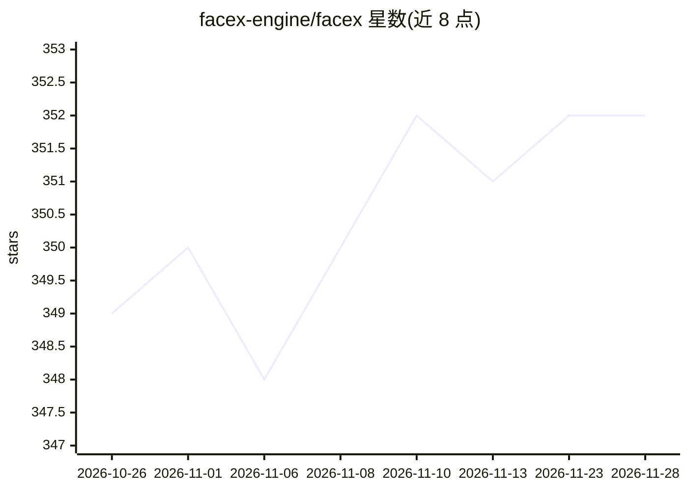

# facex-engine/facex

⭐ 352 · C · Apache-2.0 · 推送 2026-11-27 · [GitHub](https://github.com/facex-engine/facex) · [官网](https://facex-engine.github.io/facex/demo/) · 组织维护

**浏览器与本地运行的人脸检测、识别、防伪全栈库**

人脸全栈工具链：用 YuNet 检测、五点对齐，EdgeFace XS 输出 512 维识别嵌入，另有 MobileFaceNet Nano ONNX 模型（256 维）。提供 C 库与 CLI 二进制协议、Go 并发 EmbedPool、Python SDK 及 REST 容器；浏览器 SDK 以 WebAssembly 在本地运行检测与嵌入。默认构建目标为本地 CPU，仓库另含 98 点/478 点 mesh、smile 与 anti-spoof 托管 demo 所用模型。检测器头文件标注 CC BY-NC-SA，商用分发需核查组件许可。

## 筛选速览

| 维度 | 判定 | 备注 |
|---|---|---|
| AI 角色 | `ai-native` | 本体是模型或模型工具 |
| 许可风险 | `permissive` | Apache-2.0 |
| 部署形态 | `self-host` | docker 或自建部署 |
| 模型依赖 | — | README 未给出锁定关系 |
| 硬件要求 | — | 无带数字的原话,不猜 |
| 安装摩擦 | `low` | 无编译、无系统依赖或容器化 |
| 成熟度 | — | 结构信号不足 |

## 能力要点

- YuNet 检测 + EdgeFace XS 512 维嵌入，纯 CPU 推理
- C/Go/Python 三种语言接入，Go EmbedPool 支持有界队列并发
- WebAssembly 浏览器 SDK，检测与嵌入在浏览器本地运行
- REST 容器提供 /detect、/embed、/compare 接口

## 适用场景

- 在浏览器中本地完成人脸检测、对齐与比对，无需服务器
- 用 Go 服务处理并发人脸识别请求
- 在嵌入式/边缘 CPU 环境部署紧凑的人脸识别模型

## 场景标签

`人脸识别` · 领域:感知与多模态

## 证据(README 行号)

> L5: FaceX detects faces, aligns them using five landmarks and computes recognition embeddings locally. The default nativ
> L13: |Detect and recognize faces in an image|C or Python|RGB image → boxes, five landmark pairs, optional 512-component 
> L15: |Detect, align and verify in a browser|WebAssembly SDK|Canvas, image or video → faces, crops and embeddings. Serve 

## 星数曲线

2026-10-26 349 → 2026-11-28 352（+3）

---
*卡片 v1 · prompt 1.4 · 生成 2026-11-28 · 置信度 high · 依据 README sha `25c7b2cdf40f` · [字段定义](../../DATASET.md)*
