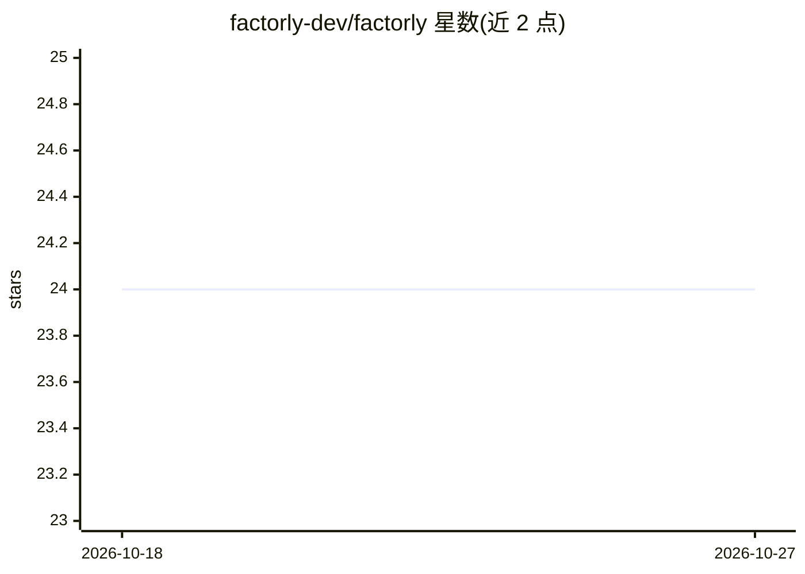

# factorly-dev/factorly

⭐ 24 · Go · GPL-3.0 · 推送 2026-10-22 · [GitHub](https://github.com/factorly-dev/factorly) · [官网](https://factorly.com) · 组织维护

**本地 agent 工具链运行时：统一管理工具调用、凭据与治理**

Factorly 是面向 AI agent 工具链的本地运行时，用一份配置统一接入 MCP 服务器、REST API 与 CLI 命令，agent 通过单一 MCP 服务器或 CLI 调用已配置的工具。核心机制：从加密 vault 注入凭据，运行时解析 {{vault:KEY}} 引用，agent 只收到工具响应而不接触凭据；内置策略、工作流（逐步策略）、审计日志与 Web UI，可先用 UI 测试工具再开放给 agent。提供 40+ 服务 blueprint（GitHub/Slack/Stripe 等）。以 Go 编写，GPL-3.0 许可。

## 筛选速览

| 维度 | 判定 | 备注 |
|---|---|---|
| AI 角色 | `ai-ecosystem` | LLM/agent 周边工具 |
| 许可风险 | `viral` | GPL-3.0 |
| 部署形态 | `library` | 以包/库形式分发 |
| 模型依赖 | — | README 未给出锁定关系 |
| 硬件要求 | — | 无带数字的原话,不猜 |
| 安装摩擦 | `low` | 无编译、无系统依赖或容器化 |
| 成熟度 | — | 结构信号不足 |

## 能力要点

- 一份配置统一接入 MCP、REST API 与 CLI 命令
- 加密 vault 凭据注入，agent 不接触凭据本身
- 带逐步策略的工作流组合与审计日志
- 40+ 服务 blueprint，可零配置包裹既有 MCP 服务器

## 适用场景

- 把分散的 MCP/REST/CLI 工具聚合给 agent 统一调用
- 给 agent 的工具调用做凭据隔离与权限治理
- 在 UI 中先测试工具再开放给 agent 使用

## 场景标签

`Agent 框架` · 领域:Agent 开发

## 证据(README 行号)

> L23: Factorly is a local runtime for agent tool chains. It manages tool calls, injects credentials from an encrypted vau
> L55: Your agent connects to Factorly as a single MCP server or CLI and sees every tool you've configured. Your agent nev

## 星数曲线

2026-10-18 24 → 2026-10-27 24（+0）

---
*卡片 v1 · prompt 1.4 · 生成 2026-10-27 · 置信度 high · 依据 README sha `2e57f105fb59` · [字段定义](../../DATASET.md)*
