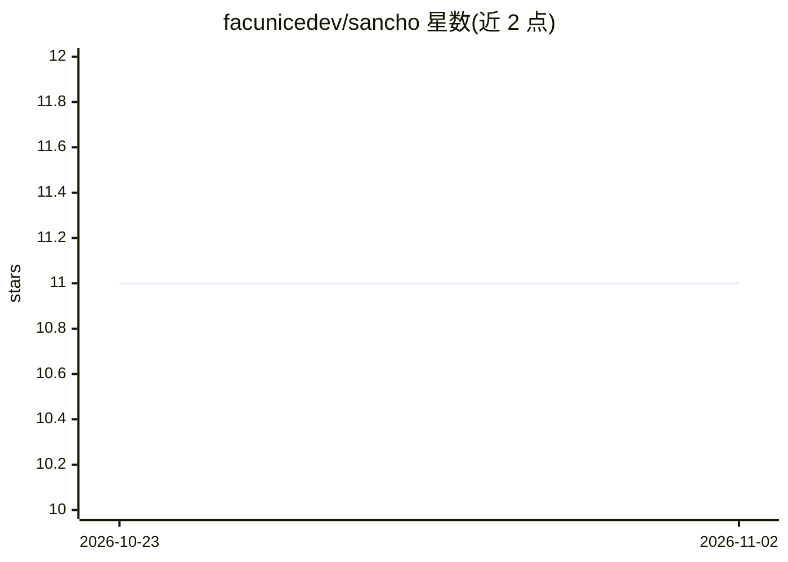

# facunicedev/sancho

⭐ 11 · Python · MIT · 推送 2026-09-05 · [GitHub](https://github.com/facunicedev/sancho) · 个人维护

**给非程序员的 Claude Code 办公工作台：规则、钩子与持久记忆**

围绕 Claude Code 构建的文件夹结构与方法论，面向做报表、邮件、办公文档而非写代码的用户。提供 rules/ 默认规则卡（数字由脚本计算、活公式、Word 排版等）、5 个 Python 钩子（3 个警告、2 个阻断，其中 the_gate.py 要求 /sign 才能写入交付物）、HANDOFF/TASKS/MEMORY/PROFILE 四个记忆文件，以及基于三次重复才生成 skill 的工作流。安装仅需 Claude Code 与 Python 3，git clone 后重置 git 历史即可。零预置 skills，不发送邮件，v0.1 版本，作者自述未完成。

## 筛选速览

| 维度 | 判定 | 备注 |
|---|---|---|
| AI 角色 | `ai-native` | 本体是模型或模型工具 |
| 许可风险 | `permissive` | MIT |
| 部署形态 | `None` |  |
| 模型依赖 | — | README 未给出锁定关系 |
| 硬件要求 | — | 无带数字的原话,不猜 |
| 安装摩擦 | `low` | 无编译、无系统依赖或容器化 |
| 成熟度 | `idea` | |

## 能力要点

- 默认规则卡（脚本算数、活公式、排版默认值等）开箱启用
- the_gate.py 阻断机制：未 /sign 前不写入交付物，签名随清单变化自动失效
- 三个自动巡检钩子：文件行数上限、仓库一致性、文件间矛盾检测
- HANDOFF/TASKS/MEMORY/PROFILE 四文件持久记忆与 /synthesis 定期整理

## 适用场景

- 让 Claude Code 记住我的文档偏好，不用每次会话重说
- 办公报表、邮件草稿等非代码工作中保持数字与文件可靠
- 积累自己岗位的操作流程为 skill

## 场景标签

`AI 助手` `AI 写作` `知识库管理` · 领域:对话与助手

## 证据(README 行号)

> L5: **A harness for Claude Code, for people whose job is not code.**
> L45: You already have Claude Code. It is good. It also forgets everything the moment you close the window, and there is 
> L152: You need Claude Code and Python 3 on your machine. Nothing else. No packages, no keys, no account, no server.

## 星数曲线

2026-10-23 11 → 2026-11-02 11（+0）

---
*卡片 v1 · prompt 1.4 · 生成 2026-11-02 · 置信度 high · 依据 README sha `4fdc7fa9fc3f` · [字段定义](../../DATASET.md)*
