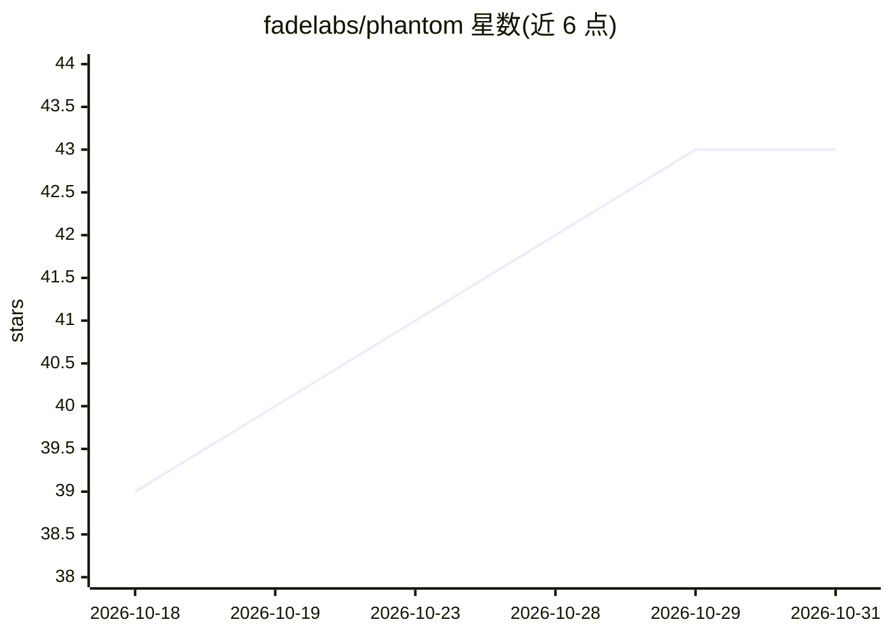

# fadelabs/phantom

⭐ 43 · Python · NOASSERTION · 推送 2026-10-05 · [GitHub](https://github.com/fadelabs/phantom) · [官网](https://fadelab.net?utm_source=github&utm_medium=repo) · 组织维护

**给 AI 助手的音频混音/母带测量工具集（CLI/库/MCP）**

面向音频工程的分析工具链：测量混音或分轨文件的响度、频谱平衡、立体声与相位、频率掩蔽，与参考文件或 9 种流派目标对比，检测削波、直流偏移、电源哼声等问题；可选 extras 提供 Pedalboard 修正处理、Matchering 参考匹配与 Demucs 分离。形态包括命令行、Python 库和暴露 20 个工具的 MCP 服务器，并附带 Claude Code 插件（5 个技能）及 Reaper/Ableton Live 的 MCP 桥接安装命令。仅支持 macOS/Linux（Python 3.10–3.13，Essentia 依赖无 Windows wheel），分析在本地运行。

## 筛选速览

| 维度 | 判定 | 备注 |
|---|---|---|
| AI 角色 | `ai-ecosystem` | LLM/agent 周边工具 |
| 许可风险 | `none` | NOASSERTION |
| 部署形态 | `None` |  |
| 模型依赖 | — | README 未给出锁定关系 |
| 硬件要求 | — | 无带数字的原话,不猜 |
| 安装摩擦 | `medium` | 含编译或系统依赖之一 |
| 成熟度 | — | 结构信号不足 |

## 能力要点

- MCP 服务器暴露 20 个音频分析/处理工具
- 与参考文件或 9 种内置流派 profile 对比
- Claude Code 插件提供 5 个混音/母带技能
- phantom setup-reaper / setup-ableton 安装 DAW 桥接

## 适用场景

- 混音前批量诊断分轨的削波、噪声与极性问题
- 让 AI 助手基于测量证据提出混音/母带方案
- 在 Reaper/Ableton 工作流中导出—测量—修改—复测

## 场景标签

 · 领域:音频工程/音乐制作

## 证据(README 行号)

> L5: Use it as a command-line tool, a Python library, or an MCP server. The Claude Code plugin adds five skills for inter
> L39: The MCP server exposes 20 tools over stdio:

## 星数曲线

2026-10-18 39 → 2026-10-31 43（+4）

---
*卡片 v1 · prompt 1.4 · 生成 2026-10-25 · 置信度 high · 依据 README sha `c26481ab4a3d` · [字段定义](../../DATASET.md)*
