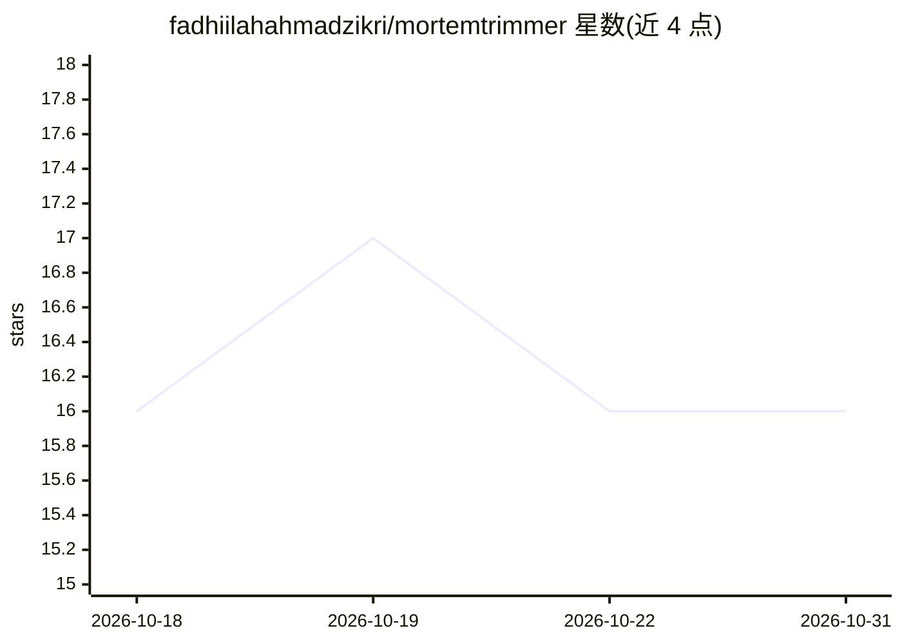

# fadhiilahahmadzikri/mortemtrimmer

⭐ 16 · Python · MIT · 推送 2026-06-11 · [GitHub](https://github.com/fadhiilahahmadzikri/mortemtrimmer) · 个人维护

**给内容创作者的 Python CLI：一键去除音视频静音并降噪**

面向 YouTuber、播客作者、视频剪辑者等创作者的命令行工具：通过 VAD 检测并剪除音视频中的静音段，再可选应用深度学习降噪，输出清理后的媒体文件。提供 3 种 VAD 引擎（Silero VAD、Whisper 语义 VAD、能量阈值）与 2 种降噪模式（DeepFilterNet3、Spectral Gating），剪接通过 FFmpeg 滤镜图实现，CUDA GPU 加速为可选项。安装方式为克隆仓库并 pip 安装依赖，系统需 Python 3.10+ 与 FFmpeg。附带导出语音段时间戳清单与可视化图表功能。

## 筛选速览

| 维度 | 判定 | 备注 |
|---|---|---|
| AI 角色 | `ai-native` | 本体是模型或模型工具 |
| 许可风险 | `permissive` | MIT |
| 部署形态 | `desktop` | 安装包/桌面程序 |
| 模型依赖 | — | README 未给出锁定关系 |
| 硬件要求 | — | 无带数字的原话,不猜 |
| 安装摩擦 | `medium` | 含编译或系统依赖之一 |
| 成熟度 | — | 结构信号不足 |

## 能力要点

- 3 种 VAD 引擎：Silero VAD、Whisper 语义 VAD、能量阈值
- 2 种降噪模式：DeepFilterNet3（深度学习）与 Spectral Gating
- 支持 MP4/MKV/AVI/MOV/WAV/MP3/AAC 等多种音视频格式
- 生成语音段时间戳清单与语音/静音时间线可视化图表

## 适用场景

- 一键剪除视频或播客中的静音段
- 给录音降噪，输出可直接发布的音视频
- 导出语音段清单检查剪辑结果

## 场景标签

`图像视频处理` · 领域:感知与多模态

## 证据(README 行号)

> L18: **Mortem** is a production-grade Python CLI tool that automatically detects and removes silent segments from audio 
> L26: |**3 VAD Engines**|Silero VAD (neural), Whisper Semantic VAD, Energy-based VAD|
> L27: |**2 Noise Reduction Modes**|DeepFilterNet3 (SOTA deep learning) & Spectral Gating|

## 星数曲线

2026-10-18 16 → 2026-10-31 16（+0）

---
*卡片 v1 · prompt 1.4 · 生成 2026-10-30 · 置信度 high · 依据 README sha `a26a3c2c022a` · [字段定义](../../DATASET.md)*
