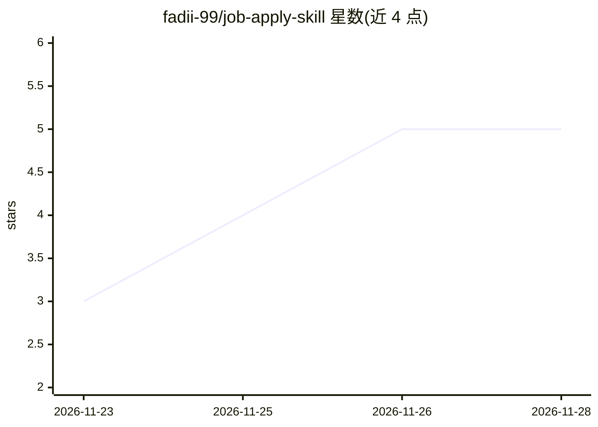

# fadii-99/job-apply-skill

⭐ 5 · Python · MIT · 推送 2026-11-21 · [GitHub](https://github.com/fadii-99/job-apply-skill) · [官网](https://github.com/fadii-99/job-apply-skill#quick-start) · 个人维护

**求职者的 Claude Code 技能：自动申请 LinkedIn 职位并生成定制 ATS 简历**

以 Claude Code skill 形式发布的求职自动化工具：读取用户项目代码构建经核验的技能清单，针对每个职位生成单栏 ATS 友好 PDF 简历，并通过 LinkedIn Easy Apply、公司招聘站（Greenhouse、Lever、Ashby、Workable 等）或 Gmail 邮件提交申请。表单答案仅来自用户档案与保存的答案，提交前逐字段回读核对；遇到 CAPTCHA/登录时暂停等待用户输入 `go` 继续。数据保留在本机 ~/.job-apply。限制：每日默认申请上限 10 个，README 声明 LinkedIn 条款禁止自动化访问，仅支持 LinkedIn 搜索职位。

## 筛选速览

| 维度 | 判定 | 备注 |
|---|---|---|
| AI 角色 | `ai-enhanced` | 去掉 AI 部分产品仍成立 |
| 许可风险 | `permissive` | MIT |
| 部署形态 | `library` | 以包/库形式分发 |
| 模型依赖 | — | README 未给出锁定关系 |
| 硬件要求 | — | 无带数字的原话,不猜 |
| 安装摩擦 | `low` | 无编译、无系统依赖或容器化 |
| 成熟度 | — | 结构信号不足 |

## 能力要点

- 读取项目代码核验技能，简历不编造内容，逐职位定制 PDF
- 支持 Easy Apply、公司招聘站与邮件三类申请渠道
- 人机协作机制：CAPTCHA/登录暂停等待 `go`，提交前回读核对字段
- 本地数据存储，重复申请保护与每日限额（默认 10）

## 适用场景

- 让 AI 代理自动搜索并申请匹配的 LinkedIn 职位
- 根据职位描述生成定制 ATS 简历并自动填表投递
- 纯邮件投递的职位自动写邮件并附简历发送

## 场景标签

`浏览器自动化` `AI 写作` · 领域:效率与自动化

## 证据(README 行号)

> L3: **An open-source Claude Code skill that finds LinkedIn jobs that fit you and applies to them automatically, from you
> L5: It reads your real project code to build a resume backed by evidence (no made-up skills), writes an ATS-friendly PDF

## 星数曲线

2026-11-23 3 → 2026-11-28 5（+2）

---
*卡片 v1 · prompt 1.4 · 生成 2026-11-23 · 置信度 mid · 依据 README sha `f7bae5968b75` · [字段定义](../../DATASET.md)*
