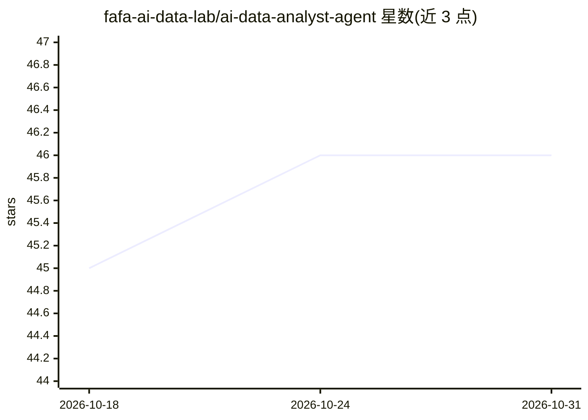

# fafa-ai-data-lab/ai-data-analyst-agent

⭐ 46 · MIT · 推送 2026-06-30 · [GitHub](https://github.com/fafa-ai-data-lab/ai-data-analyst-agent) · 组织维护 · 中文 README

**可信数据分析 AI agent 的方法论与可复用模板集**

开源一套把数据分析师工作流固化进 AI agent（Claude Code / Cursor 等 harness）的方法论与模板：口径先行的 Metric Store 语义层、物理只读独立加载规则的 validator 校验、踩坑纠正后单调增长的编号规则库，以及每个产出数字的溯源 Footer。仓库不含业务数据、表名与口径，业务填充由使用者按模板自行积累。提供 persona 模板、data-validator skill 与三步落地指引。

## 筛选速览

| 维度 | 判定 | 备注 |
|---|---|---|
| AI 角色 | `ai-knowledge` | 知识聚合/清单类 |
| 许可风险 | `permissive` | MIT |
| 部署形态 | `None` |  |
| 模型依赖 | — | README 未给出锁定关系 |
| 硬件要求 | — | 无带数字的原话,不猜 |
| 安装摩擦 | `low` | 无编译、无系统依赖或容器化 |
| 成熟度 | — | 结构信号不足 |

## 能力要点

- 指标单一权威定义的 Metric Store / 语义层模板
- 独立物理只读 validator agent（校验与自评分离）
- 纠正一次追加一条编号规则的随用随长规则库
- 数据溯源 Footer 回答口径来源、数据新鲜度与校验者

## 适用场景

- 搭建可信可追溯的数据分析 AI agent
- 为 agent 出数建立口径 registry 与校验流程
- 把业务踩坑沉淀为可自动命中的规则库

## 场景标签

`数据分析` `提示工程` · 领域:Agent 开发

## 证据(README 行号)

> L5: 一套把「数据分析师」工作流固化进 AI agent（Claude Code / Cursor / 任意支持 system prompt + skill 的 harness）的方法论与可复用模板。
> L7: 这个仓库**不包含任何业务数据、内部表名、口径或个人信息**。它开源的是「骨架」——让一个 AI agent 做数据分析时**可信、可追溯、随用随长**的机制；业务「填充」（你的表、你的指标口径、你的踩坑库）由你按模板自己积累。

## 星数曲线

2026-10-18 45 → 2026-10-31 46（+1）

---
*卡片 v1 · prompt 1.4 · 生成 2026-10-25 · 置信度 high · 依据 README sha `f44e5049ce85` · [字段定义](../../DATASET.md)*
