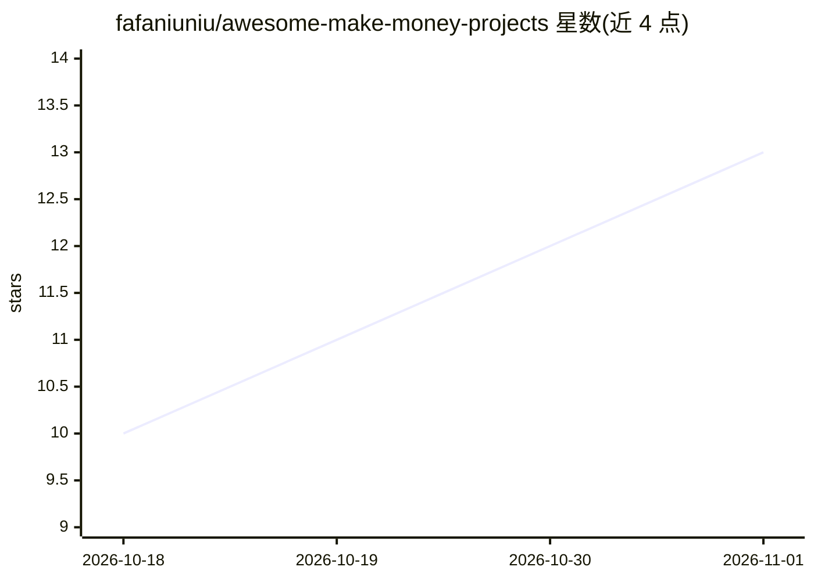

# fafaniuniu/awesome-make-money-projects

⭐ 13 · MIT · 推送 2026-05-26 · [GitHub](https://github.com/fafaniuniu/awesome-make-money-projects) · 组织维护 · 中文 README

**付费会员网站 gitcc.com 的企业级项目推广清单**

README 为 www.gitcc.com 的推广页，声称网站会员可下载大量企业级软件项目，列举 AI 客服、ERP、MES、数字孪生、YOLO 检测、数据标注、智慧矿山、AI 短剧等数十类系统名称及截图占位，并称还有一万多个开源项目。仓库本身不含代码、安装方式或技术文档，仅以中文名称罗列项目类别，导向付费会员下载站点。

## 筛选速览

| 维度 | 判定 | 备注 |
|---|---|---|
| AI 角色 | `ai-knowledge` | 知识聚合/清单类 |
| 许可风险 | `permissive` | MIT |
| 部署形态 | `None` |  |
| 模型依赖 | — | README 未给出锁定关系 |
| 硬件要求 | — | 无带数字的原话,不猜 |
| 安装摩擦 | `low` | 无编译、无系统依赖或容器化 |
| 成熟度 | — | 结构信号不足 |

## 能力要点

- 列举 60 余类企业级与 AI 相关项目名称
- 声明项目真实可靠、可运行、可部署
- 导向付费会员网站 www.gitcc.com 下载

## 适用场景

- 浏览企业级软件项目类别名录
- 了解付费下载站点宣称提供的项目范围

## 场景标签

 · 领域:软件项目推广/名录

## 证据(README 行号)

> L2: ## 欢迎登录 www.gitcc.com ，本网站会员可下载所有项目！
> L6: 包含市面上所有常见的项目，公司花百万研发的项目，现在统统免费获取！！！包括无人机智能巡检平台，数字孪生低代码平台，AI农业，MES，IOT，物联网，ERP，AI监控系统，AI医疗，模型训练，YOLO检测，舆情系统，数据中台，BI系统
> L111: ## 还有一万多个开源项目等你发现，一切尽在 www.gitcc.com !!!

## 星数曲线

2026-10-18 10 → 2026-11-01 13（+3）

---
*卡片 v1 · prompt 1.4 · 生成 2026-10-31 · 置信度 mid · 依据 README sha `d91b3dda4014` · [字段定义](../../DATASET.md)*
