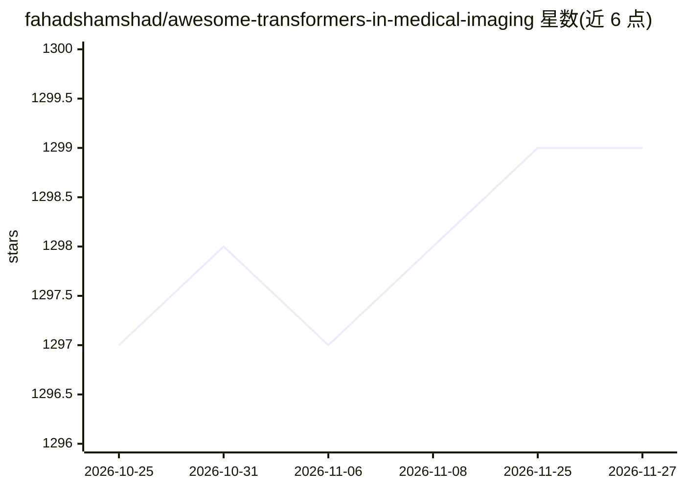

# fahadshamshad/awesome-transformers-in-medical-imaging

⭐ 1,299 · 推送 2026-11-26 · [GitHub](https://github.com/fahadshamshad/awesome-transformers-in-medical-imaging) · 组织维护

**医学影像 Transformer 论文策展清单：按任务分类供检索**

配套发表于 Medical Image Analysis 的综述《Transformers in Medical Imaging: A Survey》的论文清单，按 Survey、Segmentation 等类别以时间顺序收录论文条目，每条附作者、日期与 PDF/GitHub 链接，声明定期更新并接受社区 pull request 补充最新论文与开源实现。面向医学影像方向的研究者做文献检索与调研使用。

## 筛选速览

| 维度 | 判定 | 备注 |
|---|---|---|
| AI 角色 | `ai-knowledge` | 知识聚合/清单类 |
| 许可风险 | `none` | — |
| 部署形态 | `None` |  |
| 模型依赖 | — | README 未给出锁定关系 |
| 硬件要求 | — | 无带数字的原话,不猜 |
| 安装摩擦 | `low` | 无编译、无系统依赖或容器化 |
| 成熟度 | — | 结构信号不足 |

## 能力要点

- 按任务类别组织、时间顺序排列的论文条目
- 多数条目附 PDF 链接，部分附开源实现 GitHub 链接
- 配套期刊综述论文
- 接受研究者通过 PR 更新论文信息

## 适用场景

- 调研 Transformer 在医学影像各任务中的应用进展
- 按分割/分类等类别检索相关论文与开源代码
- 综述写作时收集参考文献线索

## 场景标签

`精选清单` · 领域:学习与行业

## 证据(README 行号)

> L5: # This repository complements our survey paper Transformers in Medical Imaging: A Survey, published in Medical Image
> L15: A curated list of awesome Transformers resources in medical imaging (**in chronological order**), inspired by the o

## 星数曲线

2026-10-25 1,297 → 2026-11-27 1,299（+2）

---
*卡片 v1 · prompt 1.4 · 生成 2026-11-27 · 置信度 high · 依据 README sha `b86b70325f55` · [字段定义](../../DATASET.md)*
