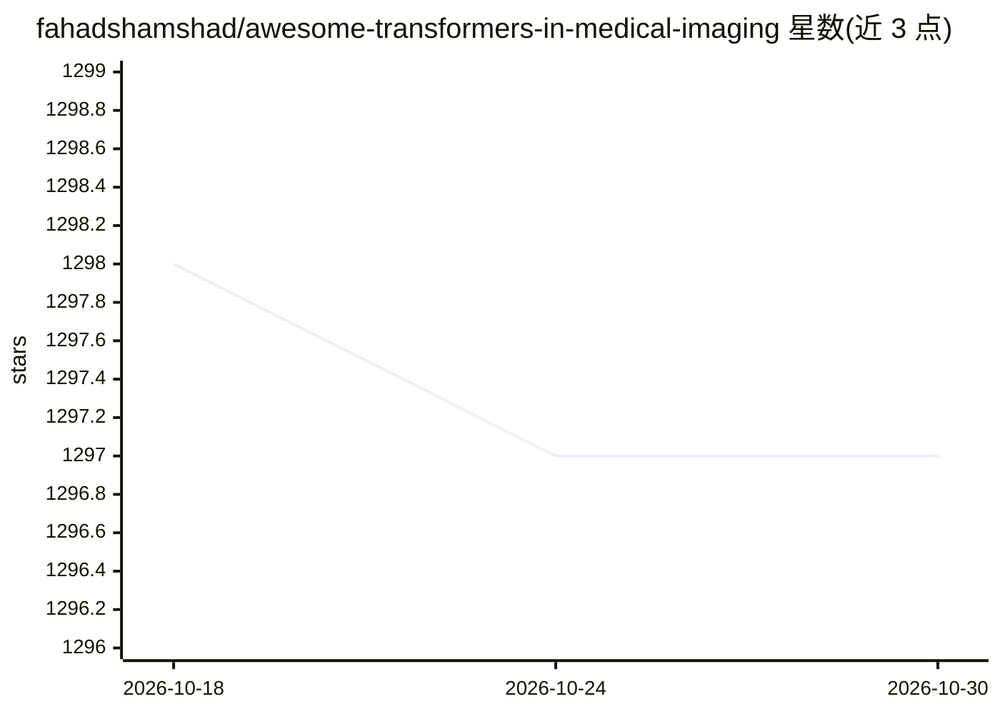

# fahadshamshad/awesome-transformers-in-medical-imaging

⭐ 1,297 · 推送 2026-06-21 · [GitHub](https://github.com/fahadshamshad/awesome-transformers-in-medical-imaging) · 组织维护

**医学影像 Transformer 论文与代码实现策展清单**

配合作者发表于 Medical Image Analysis 期刊的综述论文 Transformers in Medical Imaging: A Survey 维护的 awesome 清单：按综述、分割等类别，以时间顺序收录 Transformers 在医学影像应用的论文条目及 PDF 链接，部分条目附开源实现仓库链接，覆盖 2021-2023 年的脑肿瘤分割、皮肤病变、病理图像等方向。欢迎研究者通过 PR 补充新论文。仓库本身为纯文献列表，不含可安装代码。

## 筛选速览

| 维度 | 判定 | 备注 |
|---|---|---|
| AI 角色 | `ai-knowledge` | 知识聚合/清单类 |
| 许可风险 | `none` | — |
| 部署形态 | `None` |  |
| 模型依赖 | — | README 未给出锁定关系 |
| 硬件要求 | — | 无带数字的原话,不猜 |
| 安装摩擦 | `low` | 无编译、无系统依赖或容器化 |
| 成熟度 | — | 结构信号不足 |

## 能力要点

- 按时间顺序收录医学影像 Transformer 论文条目
- 条目附 PDF 链接，部分附开源实现仓库
- 由期刊综述论文作者维护并配套更新

## 适用场景

- 查找医学影像分割方向的 Transformer 论文及代码
- 跟进 Transformers 在医学影像的应用研究进展
- 为综述写作收集文献线索

## 场景标签

`精选清单` · 领域:学习与行业

## 证据(README 行号)

> L5: # This repository complements our survey paper Transformers in Medical Imaging: A Survey, published in Medical Image
> L15: A curated list of awesome Transformers resources in medical imaging (**in chronological order**), inspired by the o

## 星数曲线

2026-10-18 1,298 → 2026-10-30 1,297（-1）

---
*卡片 v1 · prompt 1.4 · 生成 2026-10-21 · 置信度 high · 依据 README sha `fcc3f210a7da` · [字段定义](../../DATASET.md)*
