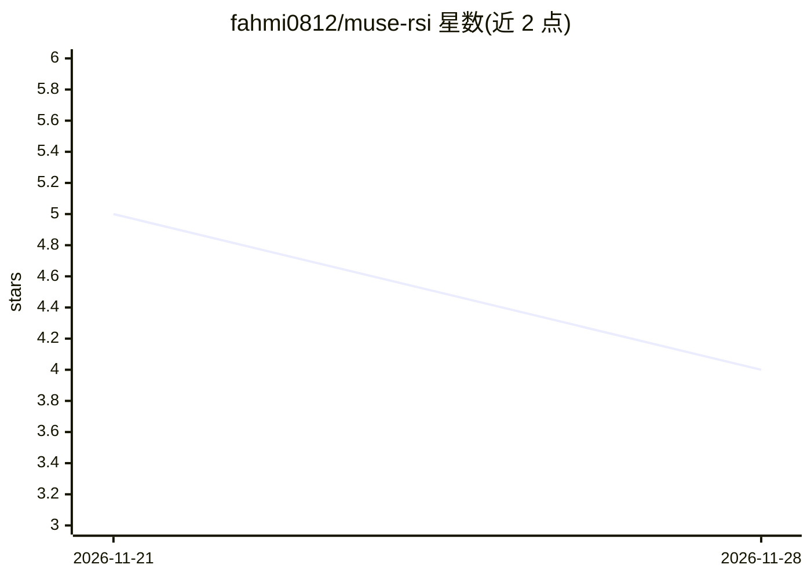

# fahmi0812/muse-rsi

⭐ 4 · Python · NOASSERTION · 推送 2026-11-27 · [GitHub](https://github.com/fahmi0812/muse-rsi) · [官网](https://github.com/fahmi0812/muse-rsi/blob/main/setup/README.md) · 个人维护

**经人工核验的 Muse agent 技能清单与一键安装系统**

从 384 个收藏仓库与 X 帖子中筛出 64 个经核验的 Muse agent 技能（含 Tier 1、DevOps、学术、全栈、办公、研究、健康等分类），逐项检查存在性、SKILL.md、许可证与更新时间；另含 9 个自创技能、覆盖 261 条目的路由器（registry.json 按 keywords/domain 匹配）及每日 RSI 循环。提供 curl 一键安装脚本或 git clone + setup.py 全系统安装，安装前自动快照、保留既有 agent 身份文件。技能条目本身仅链接上游仓库，不复制内容。

## 筛选速览

| 维度 | 判定 | 备注 |
|---|---|---|
| AI 角色 | `ai-knowledge` | 知识聚合/清单类 |
| 许可风险 | `none` | NOASSERTION |
| 部署形态 | `None` |  |
| 模型依赖 | — | README 未给出锁定关系 |
| 硬件要求 | — | 无带数字的原话,不猜 |
| 安装摩擦 | `low` | 无编译、无系统依赖或容器化 |
| 成熟度 | — | 结构信号不足 |

## 能力要点

- 64 个技能全部人工核验（存在性/SKILL.md/许可证/更新时间），核验过程写入 docs/
- 261 条目路由器按关键词匹配挑选技能，附 17 用例测试并在 CI 运行
- 9 个自创技能：rsi-loop、self-audit、anti-slop-checklist、visual-check 等
- 一键安装脚本含备份回滚机制，不覆盖 IDENTITY.md

## 适用场景

- 为 Muse/Claude 类 agent 挑选经过核验的现成技能
- 为 agent 配置按任务自动路由技能的选择器
- 建立每日审计-修复-测试-快照的自我改进循环

## 场景标签

`精选清单` `Agent 框架` · 领域:Agent 开发

## 证据(README 行号)

> L13: Most skill lists are just links. This one is a list that was checked first.
> L19: - **It routes, it doesn't just list.** The router picks the right skill for each task from 261 entries. A 17-case t
> L37: To install a skill, open its repository link above and follow that repository's own `README` / `SKILL.md`. This rep

## 星数曲线

2026-11-21 5 → 2026-11-28 4（-1）

---
*卡片 v1 · prompt 1.4 · 生成 2026-11-21 · 置信度 high · 依据 README sha `dc519b84b3f9` · [字段定义](../../DATASET.md)*
