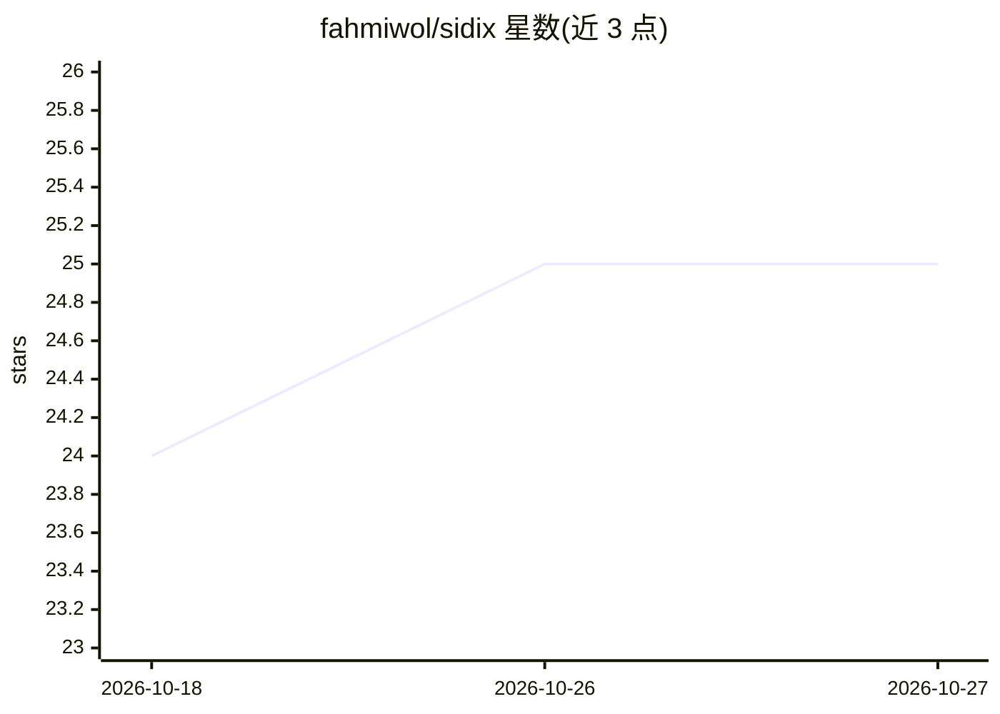

# fahmiwol/sidix

⭐ 25 · Python · MIT · 推送 2026-09-15 · [GitHub](https://github.com/fahmiwol/sidix) · [官网](https://sidixlab.com) · 个人维护

**自托管自学习 AI Agent，基于 Qwen2.5-7B+LoRA 与 IHOS 认知架构**

SIDIX 是一个 MIT 许可的开源 AI Agent 研究构建（2026年4-8月），托管应用已主动停止，当前仓库仅保留描述、许可证、作者声明与 Quran Lab provider，代码待重新打包发布。其构建快照显示：基于 Qwen2.5-7B + 4-bit QLoRA 自训适配器，FastAPI + BGE-M3 + vLLM 生产栈，含 5 层记忆（LoRA+RAG）、Raudah 多智能体并行编排、Sanad 溯源标注与 IHOS（伊斯兰整体本体论体系）守护栏，约 35 个工具覆盖编程、文案、品牌、社媒分析等。后续研究转入 MiganCore（印尼语优先模型）。

## 筛选速览

| 维度 | 判定 | 备注 |
|---|---|---|
| AI 角色 | `ai-native` | 本体是模型或模型工具 |
| 许可风险 | `permissive` | MIT |
| 部署形态 | `None` |  |
| 模型依赖 | — | README 未给出锁定关系 |
| 硬件要求 | — | 无带数字的原话,不猜 |
| 安装摩擦 | `medium` | 含编译或系统依赖之一 |
| 成熟度 | `idea` | |

## 能力要点

- Qwen2.5-7B + 4-bit QLoRA 自训适配器，本地栈无厂商 API
- Raudah 多智能体并行编排与共识综合
- Sanad 溯源链（FACT/OPINION/UNKNOWN 标注）与 Maqashid 守护栏
- 5 层记忆：不可变层 + LoRA + RAG + 夜间再训练

## 适用场景

- 在自己服务器上运行具备主动性与自学习能力的 AI Agent
- 进行带溯源标注的知识生成与研究（Quran Lab）
- 执行编程、文案、品牌与社媒分析等 35 类工具任务

## 场景标签

`多智能体` `微调` `Agent 记忆` · 领域:Agent 开发

## 证据(README 行号)

> L69: > **Not a chatbot. SIDIX is an AI Agent with initiative, opinions, and creativity.**
> L87: **Production stack (historical, April–August 2026)**: VPS (FastAPI brain · BGE-M3 CPU · 2.287 corpus docs) + RunPod
> L105: - 🧠 **Memory** — 5-layer immutable + LoRA + RAG (no catastrophic forgetting)

## 星数曲线

2026-10-18 24 → 2026-10-27 25（+1）

---
*卡片 v1 · prompt 1.4 · 生成 2026-10-27 · 置信度 mid · 依据 README sha `02c54aa3c9c7` · [字段定义](../../DATASET.md)*
