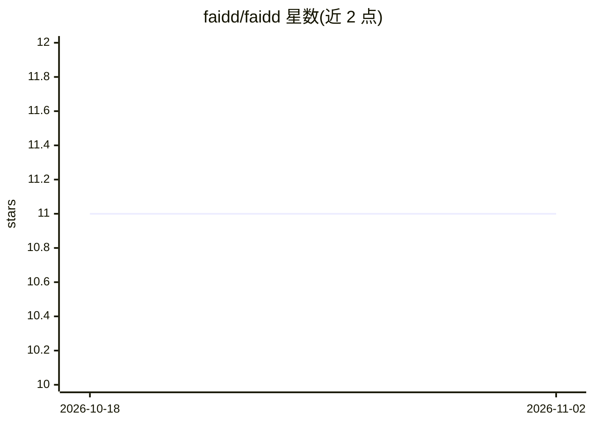

# faidd/faidd

⭐ 11 · TypeScript · Apache-2.0 · 推送 2026-02-13 · [GitHub](https://github.com/faidd/faidd) · [官网](https://www.faidd.org) · 个人维护

**为 AI 编码代理搭建工作区脚手架与治理结构的 CLI 框架**

以 npx 命令运行的 Node.js CLI 工具，为使用 Cursor、Claude-Code、Windsurf 或本地 LLM 的 AI 编码代理建立统一的工作区结构：将项目分为不可变的核心目录（Bunker，存放代理、治理规则与会话历史）与操作层目录（Brain，承载分析与架构规划），通过系统级记忆与项目级执行的分层来约束代理行为，README 称之为对项目规则与代理注意力的封装。当前版本 v0.1.8，采用 Apache 2.0 许可证。README 未提供具体配置文件格式或治理规则的实现细节。

## 筛选速览

| 维度 | 判定 | 备注 |
|---|---|---|
| AI 角色 | `ai-ecosystem` | LLM/agent 周边工具 |
| 许可风险 | `permissive` | Apache-2.0 |
| 部署形态 | `library` | 以包/库形式分发 |
| 模型依赖 | — | README 未给出锁定关系 |
| 硬件要求 | — | 无带数字的原话,不猜 |
| 安装摩擦 | `low` | 无编译、无系统依赖或容器化 |
| 成熟度 | — | 结构信号不足 |

## 能力要点

- npx faidd 一条命令完成工作区初始化（Onboarding Flow）
- Bunker/Brain 双目录分层：系统级记录与项目级执行分离
- 兼容 Cursor、Claude-Code、Windsurf 及本地 LLM 等多种 AI IDE/代理

## 适用场景

- 为 AI 编码代理建立统一的项目结构与治理规则
- 多个团队/工具间保持一致的 AI 代理工作区约定
- 管理代理会话历史与项目级规则文件

## 场景标签

`Agent 框架` · 领域:Agent 开发

## 证据(README 行号)

> L18: FAIDD establishes an **Intelligence Frame**—a physical and logical scaffold that encapsulates the agent's reasoning
> L35: FAIDD isn't built for one tool. It is the **Cognitive Layer** for the world's most powerful AI IDEs. Whether you us
> L41:     User((Architect)) --> CLI[FAIDD CLI]

## 星数曲线

2026-10-18 11 → 2026-11-02 11（+0）

---
*卡片 v1 · prompt 1.4 · 生成 2026-11-02 · 置信度 mid · 依据 README sha `75e1cabed6b8` · [字段定义](../../DATASET.md)*
