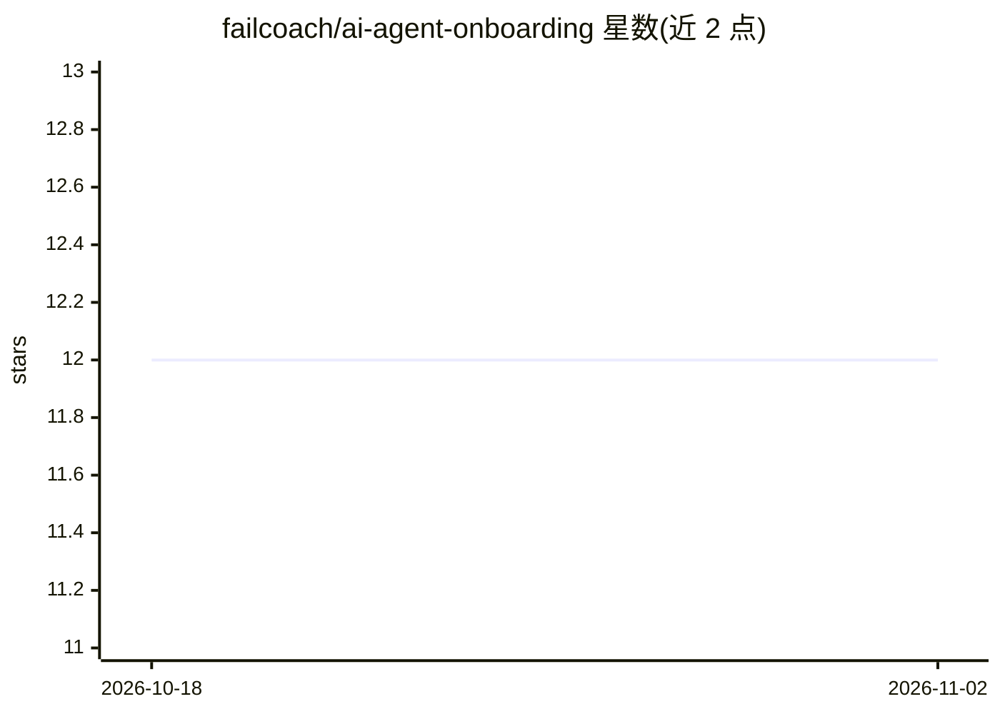

# failcoach/ai-agent-onboarding

⭐ 12 · MIT · 推送 2026-04-16 · [GitHub](https://github.com/failcoach/ai-agent-onboarding) · [官网](https://fail.coach) · 个人维护

**面向小企业主的 AI agent 上手模板与引导式访谈套件**

一套用于 Claude Code 的 starter kit：包含 20-30 分钟的交互式访谈（由 CLAUDE.md 驱动 Claude Code 提问）、6 份实操指南与即用模板，访谈后生成 agent brief、记忆结构、反馈模板和首周计划四份文档，按指定目录结构保存后由 CLAUDE.md 使 Claude Code 充当该 agent。目标用户为非技术背景的企业主；非软件、不含自动执行外部系统动作的 agent，其他平台需手动填写模板。

## 筛选速览

| 维度 | 判定 | 备注 |
|---|---|---|
| AI 角色 | `ai-knowledge` | 知识聚合/清单类 |
| 许可风险 | `permissive` | MIT |
| 部署形态 | `None` |  |
| 模型依赖 | locked-api |  |
| 硬件要求 | — | 无带数字的原话,不猜 |
| 安装摩擦 | `low` | 无编译、无系统依赖或容器化 |
| 成熟度 | — | 结构信号不足 |

## 能力要点

- CLAUDE.md 驱动的 20-30 分钟交互式访谈，生成 4 份基础文档
- 6 份指南 + 即用模板（岗位描述、记忆、反馈、时间线）
- 附 Operations Assistant 与 Tax Prep Assistant 两个完整示例
- 指南与模板为纯文本，可在无 Claude Code 环境下手动使用

## 适用场景

- 企业主按入职新员工流程搭建第一个 AI agent
- 为已有 AI agent 建立岗位说明、记忆结构与反馈机制
- 不写代码、通过访谈获得可复用的 agent 基础文档

## 场景标签

`教程课程` · 领域:学习与行业

## 证据(README 行号)

> L26: - **Interactive Interview** -- Claude Code asks about your business and the role you want filled, then generates yo
> L34: - Not software to install. It's guides, templates, and an interview process.
> L35: - Not for developers or engineers. It's for business owners who run things.

## 星数曲线

2026-10-18 12 → 2026-11-02 12（+0）

---
*卡片 v1 · prompt 1.4 · 生成 2026-11-01 · 置信度 high · 依据 README sha `6f191f3cae16` · [字段定义](../../DATASET.md)*
