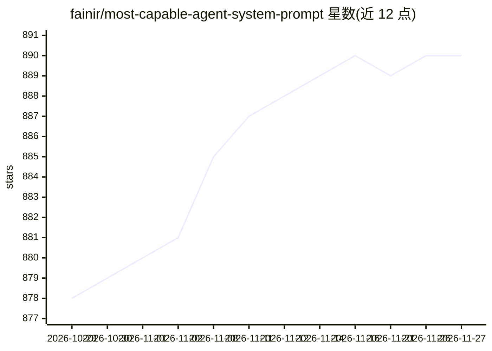

# fainir/most-capable-agent-system-prompt

⭐ 890 · MIT · 推送 2026-11-26 · [GitHub](https://github.com/fainir/most-capable-agent-system-prompt) · [官网](https://aiyourwork.chat/guides/lead-follow-up-for-service-companies?utm_source=github&utm_medium=about&utm_campaign=lead-follow-up-demo-en#sample-enquiry) · 个人维护

**给编程 Agent 用户的系统提示词：指导其搭建自改进 Agent 系统**

一份可复制粘贴的长篇系统提示词（约 2,950 行），粘贴给 Claude Code、Codex、Cursor 等编程 Agent 后，指示其立即开始搭建一套持久化、可跨会话延续的 Agent 系统：任务图、验证闭环、基于文件的记忆（AGENTS.md/tasks.md 等）、评测、治理与自改进循环。支持两种落地路径：围绕现有 Agent 的 harness 包裹模式，或基于 Agent SDK 从零构建的本地运行时模式。MIT 许可，还提供 terminal 复制命令与多种加载方式说明。

## 筛选速览

| 维度 | 判定 | 备注 |
|---|---|---|
| AI 角色 | `ai-ecosystem` | LLM/agent 周边工具 |
| 许可风险 | `permissive` | MIT |
| 部署形态 | `None` |  |
| 模型依赖 | — | README 未给出锁定关系 |
| 硬件要求 | — | 无带数字的原话,不猜 |
| 安装摩擦 | `low` | 无编译、无系统依赖或容器化 |
| 成熟度 | — | 结构信号不足 |

## 能力要点

- 单条提示词驱动 Agent 搭建含任务图、验证、文件记忆、评测与自改进循环的系统
- 文件化项目操作系统（AGENTS.md、plan.md、tasks.md 等）支持任意兼容 Agent 接续工作
- 提供 harness-wrapper 与 native runtime 两种实现路径
- 给出 Claude Code / Codex / Cursor 的具体加载命令与配置建议

## 适用场景

- 让编程 Agent 把一次性的会话成果沉淀为可跨任务延续的 Agent 系统
- 为重复性工作流（如潜在客户跟进）搭建带人工审批的自动化流程
- 用评测与验证机制检查 Agent 是否真的完成任务再收尾

## 场景标签

`提示工程` `编码 Agent` `Agent 框架` `工作流自动化` · 领域:Agent 开发

## 证据(README 行号)

> L5: A copy-paste system prompt for people who use coding agents like Claude Code, Codex, or Cursor: paste it in, and you
> L7: Left alone, most agent sessions forget everything between runs, call work done without checking it, and stall once a
> L52: 2. Start your agent in an empty folder (or in the repo you want it to extend) and paste the prompt as your first me

## 星数曲线

2026-10-28 878 → 2026-11-27 890（+12）

---
*卡片 v1 · prompt 1.4 · 生成 2026-11-27 · 置信度 high · 依据 README sha `40e4eaeb228a` · [字段定义](../../DATASET.md)*
