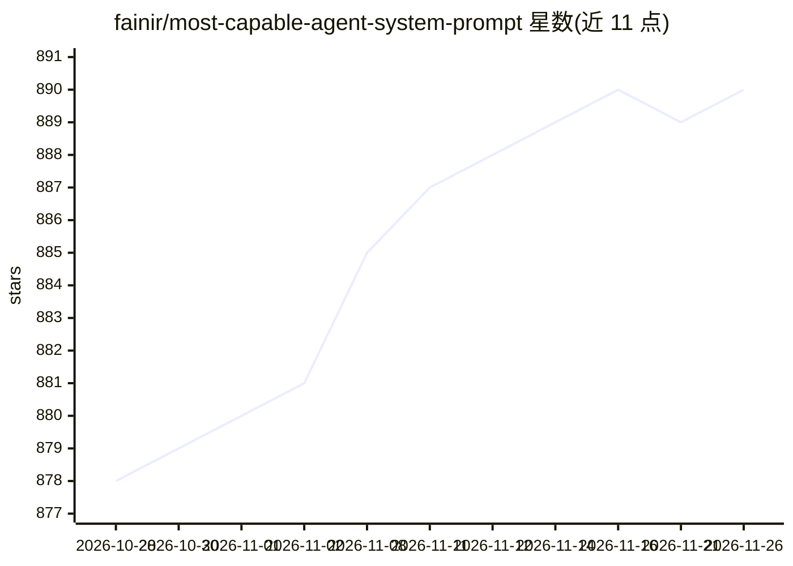

# fainir/most-capable-agent-system-prompt

⭐ 890 · MIT · 推送 2026-11-25 · [GitHub](https://github.com/fainir/most-capable-agent-system-prompt) · [官网](https://aiyourwork.chat/guides/lead-follow-up-for-service-companies?utm_source=github&utm_medium=about&utm_campaign=lead-follow-up-demo-en#sample-enquiry) · 个人维护

**给编码 Agent 用户的系统提示词：驱动其搭建自改进 agent 系统**

一份可直接粘贴的系统提示词，面向使用 Claude Code、Codex、Cursor 等编码 Agent 的用户。粘贴后指示 Agent 检查工作区、建立文件化的项目操作系统（AGENTS.md、plan.md、tasks.md 等），并按 BUILD ORDER 逐步搭建任务图、验证、记忆、评测与自改进闭环。支持 harness-wrapper（围绕现有 Agent）与 native runtime（基于 Agent SDK）两种实现路径。提示词约 2,950 行、23,000 tokens，MIT 许可。

## 筛选速览

| 维度 | 判定 | 备注 |
|---|---|---|
| AI 角色 | `ai-ecosystem` | LLM/agent 周边工具 |
| 许可风险 | `permissive` | MIT |
| 部署形态 | `None` |  |
| 模型依赖 | — | README 未给出锁定关系 |
| 硬件要求 | — | 无带数字的原话,不猜 |
| 安装摩擦 | `low` | 无编译、无系统依赖或容器化 |
| 成熟度 | — | 结构信号不足 |

## 能力要点

- 单条提示词驱动 Agent 搭建任务图、验证、文件记忆、评测与自改进闭环
- 支持 harness-wrapper 与 native runtime 两种实现路径
- 建立文件化项目协议，任何兼容 Agent 可从文件夹接续工作
- 提供终端命令一键复制提示词（macOS/Linux）

## 适用场景

- 让编码 Agent 在现有仓库上搭建可持续运行的任务系统
- 解决 Agent 会话间失忆、未验证即完工的问题
- 以文件协议交接长周期多阶段项目给其他兼容 Agent

## 场景标签

`Agent 框架` `提示工程` `编码 Agent` · 领域:Agent 开发

## 证据(README 行号)

> L5: A copy-paste system prompt for people who use coding agents like Claude Code, Codex, or Cursor: paste it in, and you
> L52: 2. Start your agent in an empty folder (or in the repo you want it to extend) and paste the prompt as your first me
> L119: - **Harness-wrapper mode** keeps your current agent (Claude Code, Codex, and so on) as the execution engine and bu

## 星数曲线

2026-10-28 878 → 2026-11-26 890（+12）

---
*卡片 v1 · prompt 1.4 · 生成 2026-11-26 · 置信度 high · 依据 README sha `e5dabf754b21` · [字段定义](../../DATASET.md)*
