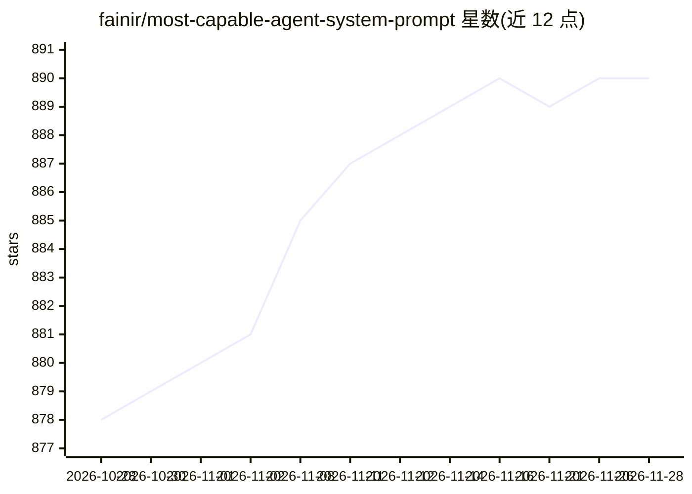

# fainir/most-capable-agent-system-prompt

⭐ 890 · MIT · 推送 2026-11-27 · [GitHub](https://github.com/fainir/most-capable-agent-system-prompt) · [官网](https://aiyourwork.chat/guides/lead-follow-up-for-service-companies?utm_source=github&utm_medium=about&utm_campaign=lead-follow-up-demo-en#sample-enquiry) · 个人维护

**一份系统提示词：让编码代理为你搭建自我改进的代理系统**

以纯文本提示词形式发布：用户将其粘贴为 Claude Code、Codex、Cursor 等编码代理的首条消息或系统提示词，代理即按提示词中的构建顺序（任务图、验证、文件记忆、评测、治理、自我改进循环）搭建一套可跨会话持续的代理系统，支持包裹现有代理（harness-wrapper）或基于 Agent SDK 从零构建两种路径。README 给出终端复制命令与三种使用方式（首条消息/系统提示词/指令文件），并注明文件约 108 KiB，Codex 需调高 project_doc_max_bytes。

## 筛选速览

| 维度 | 判定 | 备注 |
|---|---|---|
| AI 角色 | `ai-ecosystem` | LLM/agent 周边工具 |
| 许可风险 | `permissive` | MIT |
| 部署形态 | `None` |  |
| 模型依赖 | — | README 未给出锁定关系 |
| 硬件要求 | — | 无带数字的原话,不猜 |
| 安装摩擦 | `low` | 无编译、无系统依赖或容器化 |
| 成熟度 | — | 结构信号不足 |

## 能力要点

- 粘贴即用：提示词指导代理生成 AGENTS.md、tasks.md 等文件操作系统
- 支持 harness-wrapper（包裹现有代理）与 native runtime（基于 Agent SDK）两种模式
- 提供 macOS/Linux 终端一键复制提示词的命令
- 含验证闭环设计：目标→任务图→执行→验证→记忆更新

## 适用场景

- 让编码代理搭建带文件记忆与验证机制的长周期代理系统
- 将现有 Claude Code/Codex 会话升级为可持续运行的系统
- 为多步骤自动化任务（数据清理、文档验证）建立可核验的执行流程

## 场景标签

`提示工程` `编码 Agent` · 领域:Agent 开发

## 证据(README 行号)

> L5: A copy-paste system prompt for people who use coding agents like Claude Code, Codex, or Cursor: paste it in, and you
> L7: Left alone, most agent sessions forget everything between runs, call work done without checking it, and stall once a

## 星数曲线

2026-10-28 878 → 2026-11-28 890（+12）

---
*卡片 v1 · prompt 1.4 · 生成 2026-11-28 · 置信度 high · 依据 README sha `078d300efb4c` · [字段定义](../../DATASET.md)*
