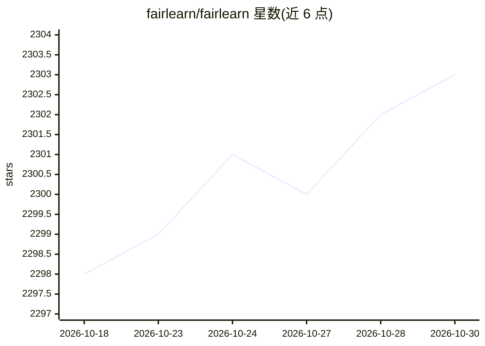

# fairlearn/fairlearn

⭐ 2,303 · Python · MIT · 推送 2026-10-24 · [GitHub](https://github.com/fairlearn/fairlearn) · [官网](https://fairlearn.org) · 组织维护

**评估并缓解机器学习模型公平性问题的 Python 库**

面向 AI 系统开发者的公平性工具包，包含两部分：Metrics 用于评估哪些群体受模型负面影响，并按多种公平性与准确性指标比较模型；Algorithms 提供多种 AI 任务和公平性定义下的不公平缓解算法。采用群体公平（group fairness）方法，关注分配伤害与服务质量伤害两类危害；需由数据科学家指定相关群体。README 提醒公平性是社会技术挑战，量化指标不能同时满足，目标是帮助人类权衡。安装方式为 pip install fairlearn，附 Jupyter 示例与用户指南。

## 筛选速览

| 维度 | 判定 | 备注 |
|---|---|---|
| AI 角色 | `ai-ecosystem` | LLM/agent 周边工具 |
| 许可风险 | `permissive` | MIT |
| 部署形态 | `library` | 以包/库形式分发 |
| 模型依赖 | — | README 未给出锁定关系 |
| 硬件要求 | — | 无带数字的原话,不猜 |
| 安装摩擦 | `low` | 无编译、无系统依赖或容器化 |
| 成熟度 | — | 结构信号不足 |

## 能力要点

- 按多种公平性指标评估模型对群体的影响
- 多种 AI 任务下的不公平缓解算法
- 基于群体公平（group fairness）框架，聚焦分配与服务质量两类伤害
- 附带示例 notebook 与用户指南

## 适用场景

- 审计我的 ML 模型对不同人群的表现差异
- 在训练流程中缓解模型的不公平问题
- 比较多组模型在公平性与准确性上的权衡

## 场景标签

`模型评测` · 领域:评测与运维

## 证据(README 行号)

> L5: Fairlearn is a Python package that empowers developers of artificial
> L60: - *Metrics* for assessing which groups are negatively impacted by a
> L64: - *Algorithms* for mitigating unfairness in a variety of AI tasks and

## 星数曲线

2026-10-18 2,298 → 2026-10-30 2,303（+5）

---
*卡片 v1 · prompt 1.4 · 生成 2026-10-21 · 置信度 high · 依据 README sha `99b57e068723` · [字段定义](../../DATASET.md)*
