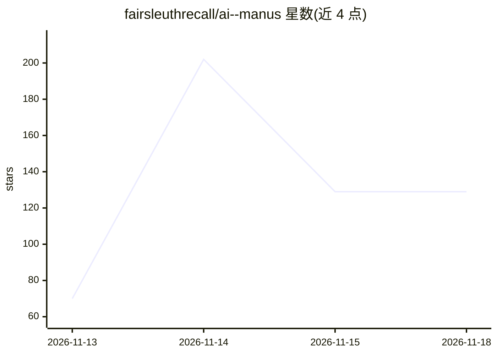

# fairsleuthrecall/ai--manus

⭐ 129 · Apache-2.0 · 推送 2026-11-15 · [GitHub](https://github.com/fairsleuthrecall/ai--manus) · 个人维护

**自主 AI Agent 桌面助手：代用户执行代码与浏览器操作**

面向家庭、学习与轻量办公场景的自主 AI Agent：用户以自然语言下达任务，Agent 自行编写并执行脚本、打开网页、填写表单、多步骤执行，支持脚本与浏览器操作在同一流程中衔接，并在长会话中重复应用已记忆的工作模式。README 未给出具体模型接入方式、安装命令或源码构建步骤，仅描述启动前准备与配置流程；兼容性表列出最低双核 CPU、4 GB 内存要求。定位为个人小任务助手，非企业平台。

## 筛选速览

| 维度 | 判定 | 备注 |
|---|---|---|
| AI 角色 | `ai-native` | 本体是模型或模型工具 |
| 许可风险 | `permissive` | Apache-2.0 |
| 部署形态 | `None` |  |
| 模型依赖 | — | README 未给出锁定关系 |
| 硬件要求 | — | 无带数字的原话,不猜 |
| 安装摩擦 | `low` | 无编译、无系统依赖或容器化 |
| 成熟度 | — | 结构信号不足 |

## 能力要点

- 自主编写并执行代码完成任务
- 浏览器控制：导航网页、填表、采集信息
- 代码与浏览器操作在同一工作流中衔接
- 跨会话记忆并重复应用工作模式

## 适用场景

- 让学生组织研究笔记、跑小脚本
- 远程工作者从多个网页收集数据
- 把重复性小任务委托给后台 Agent 处理

## 场景标签

`AI 助手` `编码 Agent` `浏览器自动化` · 领域:效率与自动化

## 证据(README 行号)

> L18: Manus is an autonomous AI agent designed to run code and control a browser on your behalf. Instead of acting like a
> L22: Manus is not a heavy studio suite or a complex enterprise platform. It is a focused helper built for home, study, a

## 星数曲线

2026-11-13 70 → 2026-11-18 129（+59）

---
*卡片 v1 · prompt 1.4 · 生成 2026-11-17 · 置信度 mid · 依据 README sha `0f78ee3a5dd2` · [字段定义](../../DATASET.md)*
