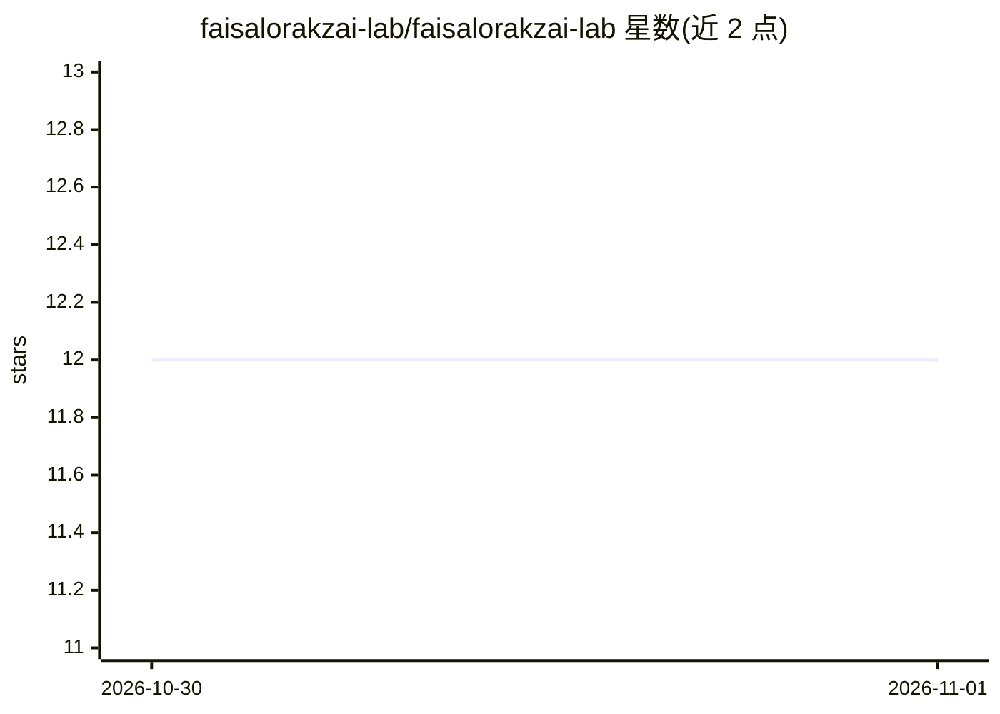

# faisalorakzai-lab/faisalorakzai-lab

⭐ 12 · MIT · 推送 2026-10-31 · [GitHub](https://github.com/faisalorakzai-lab/faisalorakzai-lab) · [官网](https://orakzai-group.github.io) · 个人维护

**个人 GitHub 主页：计算机科学家/企业家的研究兴趣与项目档案**

Muhammad Faisal Orakzai（Orakzai Group 创始人）的 GitHub 个人主页 README，内容包括：个人简介、计算机科学研究议程（分布式系统、形式化方法、AI 系统评测、应用系统研究）、在研与已上线项目清单（ModelDiff、Orakzai DeFi Exchange、OKBOND、Shamim Forever 等）、出版的两本 Kindle 书籍、研究记录入口、技术栈罗列及协作与联系方式。本仓库为个人档案页，无可安装或运行的软件；项目细节需查阅各仓库自身的 README。

## 筛选速览

| 维度 | 判定 | 备注 |
|---|---|---|
| AI 角色 | `ai-knowledge` | 知识聚合/清单类 |
| 许可风险 | `permissive` | MIT |
| 部署形态 | `None` |  |
| 模型依赖 | — | README 未给出锁定关系 |
| 硬件要求 | — | 无带数字的原话,不猜 |
| 安装摩擦 | `low` | 无编译、无系统依赖或容器化 |
| 成熟度 | — | 结构信号不足 |

## 能力要点

- 列出研究议程：分布式系统、形式化方法（TLA+/Coq）、AI 系统评测
- 收录 ModelDiff（本地 AI 模型/提示词的离线回归测试）等所选项目条目
- 罗列 AI/ML（PyTorch、TensorFlow、OpenCV、scikit-learn）与区块链/全栈技术栈

## 适用场景

- 了解该作者的计算机科学研究方向与兴趣
- 查找其开源项目（如 ModelDiff）与上线站点的入口
- 通过链接访问其书籍、研究记录与联系渠道

## 场景标签

 · 领域:个人技术档案/研究导航

## 证据(README 行号)

> L30: - **AI systems evaluation:** How can model, prompt, and inference changes be tested reproducibly, with regressions 
> L49: |ModelDiff|Offline-first regression testing for local AI models, prompts, and inference configurations.|

## 星数曲线

2026-10-30 12 → 2026-11-01 12（+0）

---
*卡片 v1 · prompt 1.4 · 生成 2026-11-01 · 置信度 low · 依据 README sha `81fdce8396b6` · [字段定义](../../DATASET.md)*
