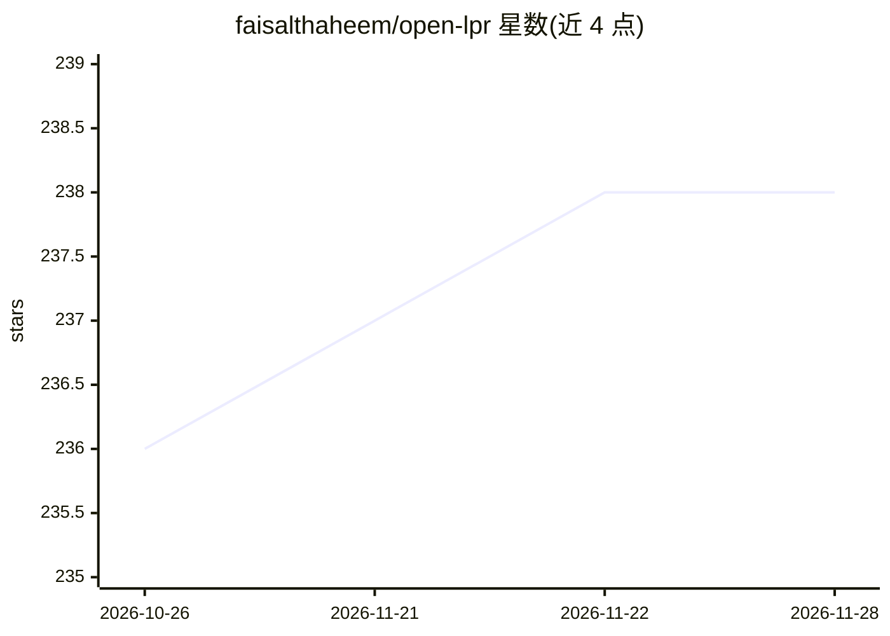

# faisalthaheem/open-lpr

⭐ 238 · Python · Apache-2.0 · 推送 2026-11-17 · [GitHub](https://github.com/faisalthaheem/open-lpr) · 个人维护

**对图片做车牌检测与文字识别的开源 Web 应用**

Django 后端加 Next.js SPA 前端的车牌识别应用：默认在进程内以 ONNX Runtime 运行 YOLOX-tiny 检测器与 PP-OCRv5 CTC 识别器，CPU 推理、无外部 API；通过环境变量可切换到 Qwen3-VL 等 OpenAI 兼容端点的视觉语言模型后端。提供网页拖拽上传、边界框可视化、处理历史检索、REST API、Prometheus 延迟指标与 Docker Compose 部署；模型工件约 37MB，首次启动自动下载并校验，Apache 2.0 许可。

## 筛选速览

| 维度 | 判定 | 备注 |
|---|---|---|
| AI 角色 | `ai-native` | 本体是模型或模型工具 |
| 许可风险 | `permissive` | Apache-2.0 |
| 部署形态 | `self-host` | docker 或自建部署 |
| 模型依赖 | — | README 未给出锁定关系 |
| 硬件要求 | `cpu-ok` | |
| 安装摩擦 | `low` | 无编译、无系统依赖或容器化 |
| 成熟度 | — | 结构信号不足 |

## 能力要点

- 进程内 YOLOX-tiny 检测 + PP-OCRv5 识别，CPU 推理约 60ms/图，无需 GPU 与外部 API
- PIPELINE_BACKEND=llm 可切换 Qwen3-VL 等 OpenAI 兼容端点，单变量回滚
- Docker Compose profile 化部署，含 Prometheus/Grafana 延迟监控
- 提供 REST API 与网页端拖拽上传、边界框可视化

## 适用场景

- 搭建自有车牌识别服务，离线处理上传图片
- 通过 REST API 程序化调用车牌检测与 OCR
- 在 CPU 环境下部署无需 GPU 的识别管线

## 场景标签

`OCR` `目标检测` · 领域:感知与多模态

## 证据(README 行号)

> L10: *A Django web application with a Next.js SPA frontend that detects and recognises
> L46: - 🤖 **In-Process Detection**: YOLOX-tiny plate detector running on ONNX Runtime — ~60ms per image on CPU, no GPU an
> L47: - 🔍 **On-Device OCR**: PP-OCRv5 CTC recogniser reads plate text with confidence scores; CPU inference needs only `o

## 星数曲线

2026-10-26 236 → 2026-11-28 238（+2）

---
*卡片 v1 · prompt 1.4 · 生成 2026-11-25 · 置信度 high · 依据 README sha `b0b698316fe7` · [字段定义](../../DATASET.md)*
