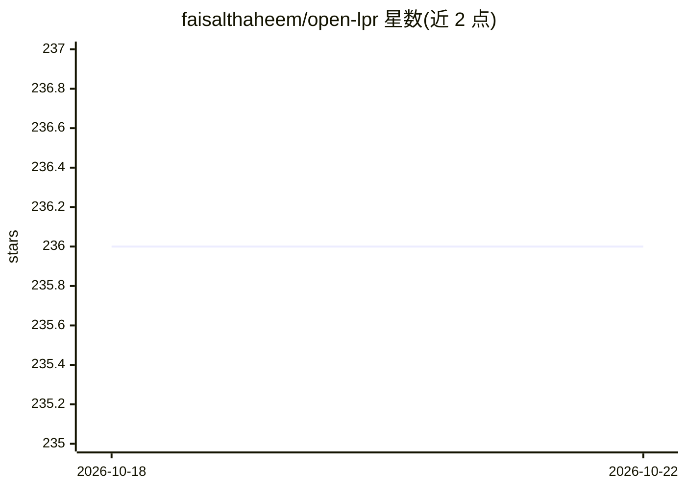

# faisalthaheem/open-lpr

⭐ 236 · Python · Apache-2.0 · 推送 2026-10-06 · [GitHub](https://github.com/faisalthaheem/open-lpr) · 个人维护

**开源车牌识别系统：Django+Next.js 网页应用，CPU 本地推理**

Django 后端加 Next.js SPA 前端的网页应用，上传图片后检测并识别车牌：YOLOX-tiny 检测器与 PP-OCRv5 CTC 识别器默认以 ONNX Runtime 在进程内 CPU 推理，无需 GPU 与外部 API；可经 PIPELINE_BACKEND=llm 切换到 Qwen3-VL 等任意 OpenAI 兼容端点（含 LlamaCpp 容器配置）。提供拖拽上传、边界框可视化、处理历史检索、REST API、Prometheus 延迟指标与 Grafana 看板，以 Docker Compose profile 方式部署，也可 Python 3.10+ 手动安装。README 提示生产环境应使用 tagged release 而非 mainline 分支。

## 筛选速览

| 维度 | 判定 | 备注 |
|---|---|---|
| AI 角色 | `ai-native` | 本体是模型或模型工具 |
| 许可风险 | `permissive` | Apache-2.0 |
| 部署形态 | `self-host` | docker 或自建部署 |
| 模型依赖 | — | README 未给出锁定关系 |
| 硬件要求 | `cpu-ok` | |
| 安装摩擦 | `low` | 无编译、无系统依赖或容器化 |
| 成熟度 | — | 结构信号不足 |

## 能力要点

- YOLOX-tiny + PP-OCRv5 ONNX 模型进程内 CPU 推理，~60ms/图，无需 GPU 与外部 API
- PIPELINE_BACKEND=llm 一键切换 Qwen3-VL / OpenAI 兼容端点或 LlamaCpp 容器后端
- 拖拽上传、边界框可视化、处理历史搜索与 REST API
- Per-stage 与端到端延迟导出为 Prometheus 指标（0.5s 预算）

## 适用场景

- 上传图片检测并读出车牌文字与坐标
- 通过 REST API 做程序化车牌识别
- 在无 GPU 服务器上以 Docker 部署本地车牌识别服务

## 场景标签

 · 领域:计算机视觉/车牌识别

## 证据(README 行号)

> L10: *A Django web application with a Next.js SPA frontend that detects and recognises
> L46: - 🤖 **In-Process Detection**: YOLOX-tiny plate detector running on ONNX Runtime — ~60ms per image on CPU, no GPU an
> L47: - 🔍 **On-Device OCR**: PP-OCRv5 CTC recogniser reads plate text with confidence scores; CPU inference needs only `o

## 星数曲线

2026-10-18 236 → 2026-10-22 236（+0）

---
*卡片 v1 · prompt 1.4 · 生成 2026-10-22 · 置信度 high · 依据 README sha `550768265b80` · [字段定义](../../DATASET.md)*
