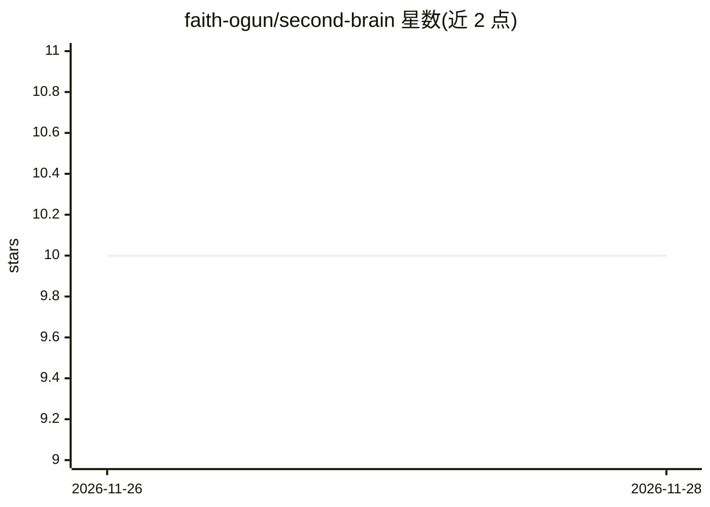

# faith-ogun/second-brain

⭐ 10 · Python · MIT · 推送 2026-11-27 · [GitHub](https://github.com/faith-ogun/second-brain) · [官网](https://faith-ogun.github.io/) · 个人维护

**供 AI agent 读写导航的纯 Markdown 第二大脑模板**

一套以纯 Markdown 文件夹组织的知识库模板与编目约定，供 Claude Code 等 agent 读取、写入并在其中定位信息。以 CLAUDE.md、_meta/VAULT.md 等规则文件承载 agent 行为约定，按程序性/语义/情景三类记忆划分文件夹结构，每个流程以人工审批为终点。无数据库、无向量索引、无插件依赖，作者称已在 PhD、创业项目与黑客松项目中日常使用；安装即 git clone 模板并复制目录。

## 筛选速览

| 维度 | 判定 | 备注 |
|---|---|---|
| AI 角色 | `ai-knowledge` | 知识聚合/清单类 |
| 许可风险 | `permissive` | MIT |
| 部署形态 | `None` |  |
| 模型依赖 | — | README 未给出锁定关系 |
| 硬件要求 | — | 无带数字的原话,不猜 |
| 安装摩擦 | `low` | 无编译、无系统依赖或容器化 |
| 成熟度 | — | 结构信号不足 |

## 能力要点

- 三类记忆（程序性/语义/情景）映射到文件夹结构的约定
- CLAUDE.md 规则文件使 agent 进入 vault 即知编目规则
- 论文-日 loop 示例：agent 摘录、链接、人工审批收尾
- 纯 Markdown 与 wikilinks，无向量数据库/RAG 服务

## 适用场景

- 为 PhD/科研项目建立 agent 可持续读写的资料库
- 创业或侧项目中记录决策与迭代日志
- 交接项目时让新会话或他人从 vault 快速上手
- 写报告/申请时让每条论断回溯到对应笔记

## 场景标签

`Agent 记忆` `知识库管理` `科研工具` · 领域:Agent 开发

## 证据(README 行号)

> L7:  A plain-markdown brain that an AI agent can actually read, write to, and find its way around.
> L35: This is the other fix. You give the model a **place to remember**: a folder of markdown files,
> L41: pipeline, no RAG service. It is directories and text files, which means you can read it, grep it,

## 星数曲线

2026-11-26 10 → 2026-11-28 10（+0）

---
*卡片 v1 · prompt 1.4 · 生成 2026-11-26 · 置信度 high · 依据 README sha `871d0384d856` · [字段定义](../../DATASET.md)*
