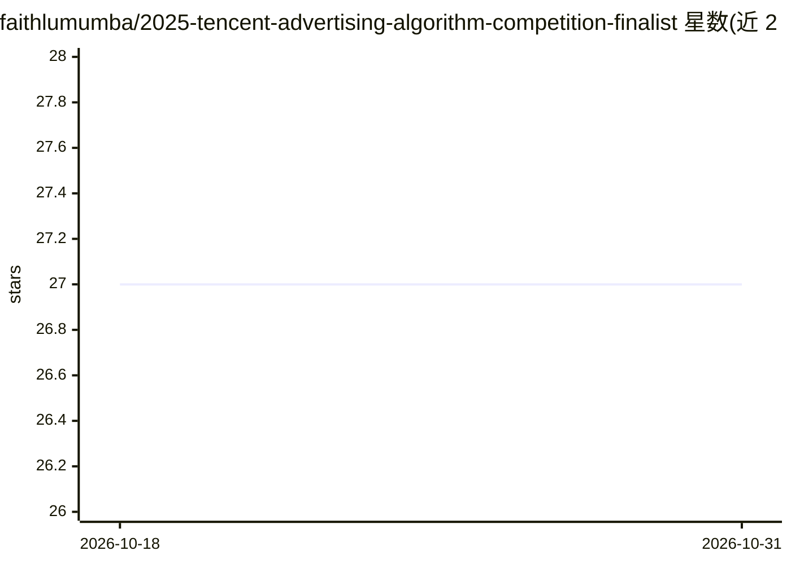

# faithlumumba/2025-tencent-advertising-algorithm-competition-finalist

⭐ 27 · Python · Apache-2.0 · 推送 2026-10-13 · [GitHub](https://github.com/faithlumumba/2025-tencent-advertising-algorithm-competition-finalist) · 个人维护 · 中文 README

**面向广告算法竞赛的生成式推荐应用：下载即用的桌面程序**

自称是 2025 腾讯广告算法竞赛决赛方案的生成式推荐（Generative Recommendation）应用。README 以桌面应用形式描述：从 GitHub Releases 下载 zip 压缩包（如 advertising-finalist-tencent-algorithm-competition-3.2-alpha.3.zip），解压后双击运行，创建账户、设置偏好、导入广告数据。声称功能含个性化生成式推荐、界面导航、表现追踪与数据洞察。系统要求 Windows 10+/macOS 10.15+/Linux、4 GB 内存、500 MB 空间与联网。README 未给出任何算法实现、代码结构或训练细节，无可验证的模型信息。

## 筛选速览

| 维度 | 判定 | 备注 |
|---|---|---|
| AI 角色 | `ai-native` | 本体是模型或模型工具 |
| 许可风险 | `permissive` | Apache-2.0 |
| 部署形态 | `desktop` | 安装包/桌面程序 |
| 模型依赖 | — | README 未给出锁定关系 |
| 硬件要求 | — | 无带数字的原话,不猜 |
| 安装摩擦 | `low` | 无编译、无系统依赖或容器化 |
| 成熟度 | — | 结构信号不足 |

## 能力要点

- 自称生成式推荐（Generative Recommendation）解决方案
- 以 Releases 页 zip 压缩包形式分发桌面应用
- 要求 4 GB 内存、500 MB 存储与联网初始设置
- README 声称含表现追踪与广告数据导入功能

## 适用场景

- 按 README 指引下载并运行该竞赛方案应用
- 导入自有广告数据查看推荐与数据洞察功能

## 场景标签

`推荐系统` · 领域:学习与行业

## 证据(README 行号)

> L5: Welcome to the 2025 Tencent Advertising Algorithm Competition Finalist project! This software offers an innovative s
> L24: - **Generative Recommendations:** Advanced algorithms for personalized suggestions

## 星数曲线

2026-10-18 27 → 2026-10-31 27（+0）

---
*卡片 v1 · prompt 1.4 · 生成 2026-10-26 · 置信度 low · 依据 README sha `761438fe033a` · [字段定义](../../DATASET.md)*
