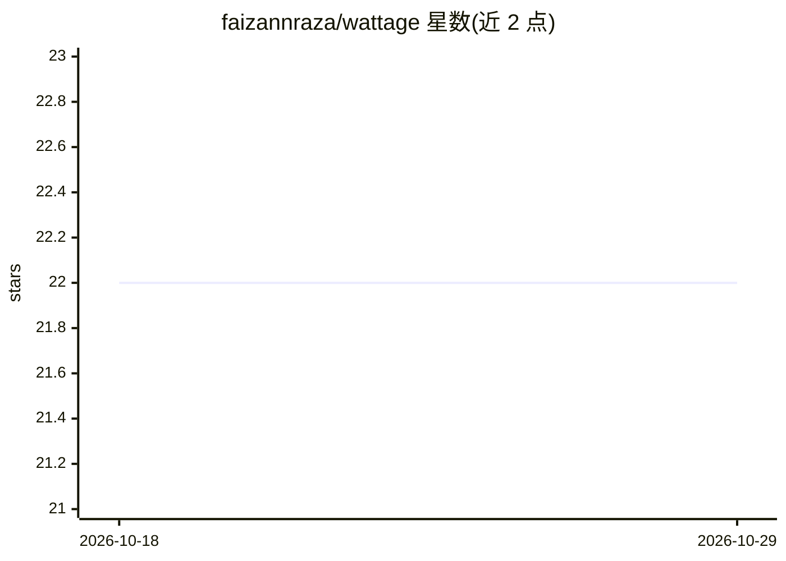

# faizannraza/wattage

⭐ 22 · Python · Apache-2.0 · 推送 2026-08-24 · [GitHub](https://github.com/faizannraza/wattage) · 个人维护

**AI agent 的 token 开销分析与 CI 成本回归门禁工具**

面向发布 LLM agent 的团队的 CLI 工具：读取现有会话日志与追踪数据（本地 Claude Code 会话、任意 OpenTelemetry GenAI 追踪导出），按带日期的定价快照（覆盖 Anthropic/OpenAI/Google/Mistral/xAI 共 52 个模型）对每次调用计价，运行 10 个浪费模式检测器，每条发现标注美元数额与修复建议，并提供在 CI 中失败构建的成本回归门禁。全离线运行，无需 API key。输出终端报告、自包含 HTML burn map、SARIF/JUnit 及徽章。

## 筛选速览

| 维度 | 判定 | 备注 |
|---|---|---|
| AI 角色 | `ai-ecosystem` | LLM/agent 周边工具 |
| 许可风险 | `permissive` | Apache-2.0 |
| 部署形态 | `library` | 以包/库形式分发 |
| 模型依赖 | — | README 未给出锁定关系 |
| 硬件要求 | — | 无带数字的原话,不猜 |
| 安装摩擦 | `low` | 无编译、无系统依赖或容器化 |
| 成熟度 | — | 结构信号不足 |

## 能力要点

- 10 个浪费模式检测器，每条发现附金额与修复建议
- 基于实测追踪的 CI 成本回归门禁（含提交式基线）
- 读取 Claude Code 会话与 OpenTelemetry GenAI 追踪，格式自动检测
- 52 个模型带日期与来源的定价快照，全离线无需 API key

## 适用场景

- 在 CI 中拦截使 agent token 开销增加的 PR
- 分析 Claude Code 会话或 OTel 追踪中的 token 浪费并生成 HTML burn map
- 为 README 生成 token 效率徽章

## 场景标签

`LLM 可观测性` · 领域:评测与运维

## 证据(README 行号)

> L13: Wattage reads the traces and session logs your agents already produce — your
> L18: one thing no dashboard gives you: a **CI cost-regression gate** that fails
> L55: This is the part no other open-source tool ships: a cost-regression gate

## 星数曲线

2026-10-18 22 → 2026-10-29 22（+0）

---
*卡片 v1 · prompt 1.4 · 生成 2026-10-27 · 置信度 high · 依据 README sha `ba5d4eec73ff` · [字段定义](../../DATASET.md)*
