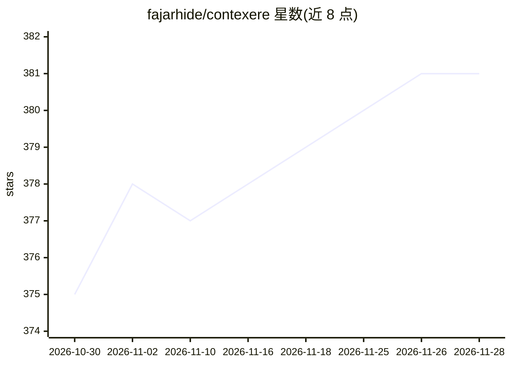

# fajarhide/contexere

⭐ 381 · Rust · Apache-2.0 · 推送 2026-11-26 · [GitHub](https://github.com/fajarhide/contexere) · [官网](https://omni.weekndlabs.com/docs) · 个人维护

**压缩 Agent 上下文并脱敏凭证的 CLI 中间层**

作为一层嵌入 Claude Code、Codex、Cursor 等编码 Agent 与模型之间的工具：在模型读取前改写工具输出，移除进度噪音、折叠已读文件为单行句柄，并将输出中的 token/密码替换为 [REDACTED]，原始内容保留在本机可回查。支持 Full/Handoff-first/MCP-only 三档接入层级，提供 init/doctor/stats 子命令与 hook 自检。当前发布的是上下文与 token 压缩部分；技能、密钥托管与跨机记忆功能尚未发布。

## 筛选速览

| 维度 | 判定 | 备注 |
|---|---|---|
| AI 角色 | `ai-ecosystem` | LLM/agent 周边工具 |
| 许可风险 | `permissive` | Apache-2.0 |
| 部署形态 | `None` |  |
| 模型依赖 | — | README 未给出锁定关系 |
| 硬件要求 | — | 无带数字的原话,不猜 |
| 安装摩擦 | `low` | 无编译、无系统依赖或容器化 |
| 成熟度 | `idea` | |

## 能力要点

- 改写工具输出：去进度噪音、已读文件折叠为句柄
- 输出中的凭证替换为 [REDACTED]，原内容留在本机
- 三种接入层级覆盖十余个编码 Agent
- 每条命令约 21 ms 开销，提供 stats 统计实际节省

## 适用场景

- 降低编码 Agent 的 token 消耗与成本
- 防止命令输出中的密钥进入模型上下文
- 在多个 Agent 间保持一致的上下文处理行为

## 场景标签

 · 领域:开发者工具/Agent 基础设施

## 证据(README 行号)

> L17:  Contexere as one layer woven between Claude Code, Codex, Cursor, Gemini CLI, OpenClaw, Hermes, Pi and VS Code. Red
> L29: Contexere takes out what the model does not need, before the model reads it. Nothing is deleted: whatever it remove
> L73: |**Full** (rewrites tool output before the model reads it)|Claude Code, Codex CLI, Gemini CLI, OpenClaw, Hermes, Pi

## 星数曲线

2026-10-30 375 → 2026-11-28 381（+6）

---
*卡片 v1 · prompt 1.4 · 生成 2026-11-27 · 置信度 high · 依据 README sha `503c66db7d45` · [字段定义](../../DATASET.md)*
