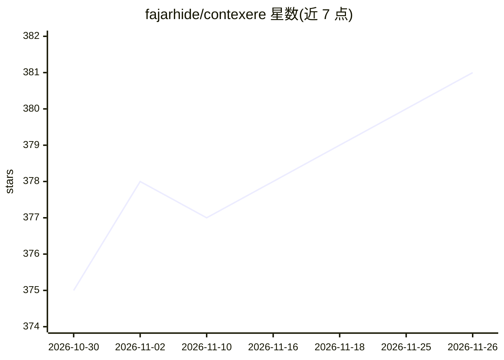

# fajarhide/contexere

⭐ 381 · Rust · Apache-2.0 · 推送 2026-11-25 · [GitHub](https://github.com/fajarhide/contexere) · [官网](https://omni.weekndlabs.com/docs) · 个人维护

**为多个 AI 编码代理压缩工具输出并脱敏凭证的 CLI 中间层**

以 hook 方式嵌入 Claude Code、Codex、Cursor 等编码代理的工具执行链路：在模型读取前改写工具输出，移除进度噪声、用句柄替代重复读取的文件、将输出中的令牌/密码替换为 [REDACTED]，失败命令原文透传；被移除内容保留在本机可恢复。支持三级集成（完整改写、handoff、仅 MCP 记忆），提供 doctor 检查与 stats 统计，单命令约 21ms 开销。目前交付上下文缩减部分，技能/密钥/记忆功能在建。

## 筛选速览

| 维度 | 判定 | 备注 |
|---|---|---|
| AI 角色 | `ai-ecosystem` | LLM/agent 周边工具 |
| 许可风险 | `permissive` | Apache-2.0 |
| 部署形态 | `None` |  |
| 模型依赖 | — | README 未给出锁定关系 |
| 硬件要求 | — | 无带数字的原话,不猜 |
| 安装摩擦 | `low` | 无编译、无系统依赖或容器化 |
| 成熟度 | `idea` | |

## 能力要点

- 改写工具输出：保留结果与失败、丢弃进度噪声
- 输出中的凭证以 [REDACTED] 脱敏后再交给模型
- 已读文件以句柄引用替代重复传输
- contexere doctor 检查各代理 hook 与脱敏生效情况

## 适用场景

- 降低编码代理的 token 消耗与账单
- 防止构建/测试输出中的密钥泄露给模型
- 在同一套工作流下使用多个编码代理工具

## 场景标签

 · 领域:开发者工具/AI 代理基础设施

## 证据(README 行号)

> L17:  Contexere as one layer woven between Claude Code, Codex, Cursor, Gemini CLI, OpenClaw, Hermes, Pi and VS Code. Red
> L29: Contexere takes out what the model does not need, before the model reads it. Nothing is deleted: whatever it remove
> L73: |**Full** (rewrites tool output before the model reads it)|Claude Code, Codex CLI, Gemini CLI, OpenClaw, Hermes, Pi

## 星数曲线

2026-10-30 375 → 2026-11-26 381（+6）

---
*卡片 v1 · prompt 1.4 · 生成 2026-11-25 · 置信度 high · 依据 README sha `9c0337e57c46` · [字段定义](../../DATASET.md)*
