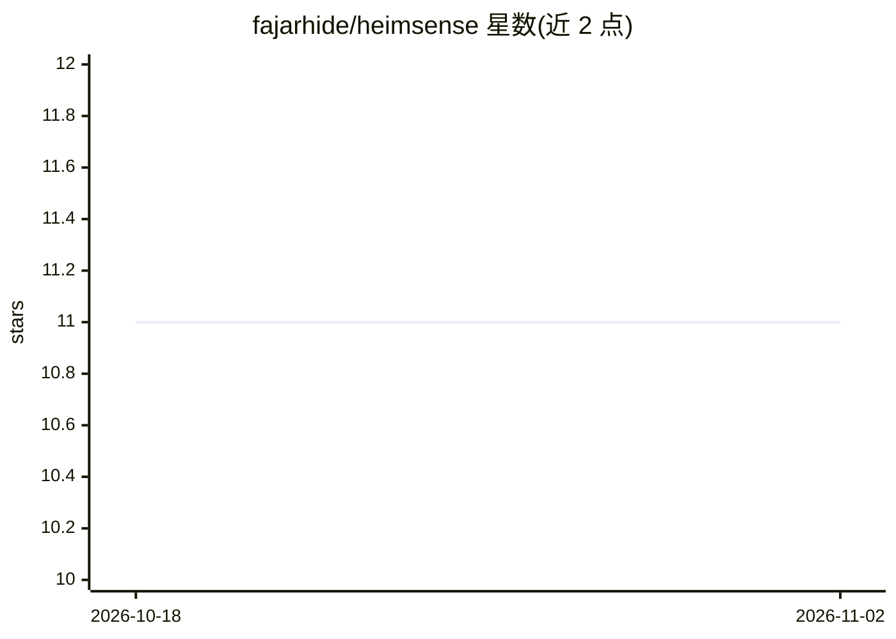

# fajarhide/heimsense

⭐ 11 · Go · MIT · 推送 2026-10-01 · [GitHub](https://github.com/fajarhide/heimsense) · 个人维护

**让 Claude Code 运行在任意 OpenAI 兼容模型上的翻译代理**

单个 Go 二进制形式的本地代理：接收 Anthropic Messages 格式请求，转换为 OpenAI 格式转发至目标供应商，响应（含流式与工具调用）再翻译回 Anthropic 格式。面向想在 DeepSeek、Groq、OpenRouter 或自托管 vLLM/Ollama 上使用 Claude Code 工作流的开发者与需数据留在内网自建服务器的团队。通过安装脚本下载二进制，heimsense setup 交互式配置，监听 :8080。限制：作者自称是适配器而非组织级 AI 网关，无虚拟密钥、团队预算、SSO 等能力，此类需求指向 LiteLLM。

## 筛选速览

| 维度 | 判定 | 备注 |
|---|---|---|
| AI 角色 | `ai-ecosystem` | LLM/agent 周边工具 |
| 许可风险 | `permissive` | MIT |
| 部署形态 | `desktop` | 安装包/桌面程序 |
| 模型依赖 | local-ok | 支持本地模型 |
| 硬件要求 | — | 无带数字的原话,不猜 |
| 安装摩擦 | `low` | 无编译、无系统依赖或容器化 |
| 成熟度 | — | 结构信号不足 |

## 能力要点

- Anthropic↔OpenAI 格式双向翻译，支持流式与工具调用
- 单个 Go 二进制分发，无 Python/Node.js/数据库依赖，内存典型低于 20MB
- 兼容云服务商（OpenAI/DeepSeek/Groq/OpenRouter 等）与本地实现（Ollama/vLLM/LM Studio/LocalAI）
- 提供 5xx 指数退避重试、优雅关停与 /health 健康检查，容器镜像约 15MB

## 适用场景

- 在更便宜或本地模型上继续使用 Claude Code 工作流
- 将基于 Anthropic API 的 agent 无需改写即切换到其他供应商
- 数据不出内网：请求路由到自建 vLLM 或 Ollama 服务器

## 场景标签

`模型网关` · 领域:Agent 开发

## 证据(README 行号)

> L15: Heimsense runs Claude Code, and agents built on the Anthropic Messages API, on any OpenAI-compatible model: DeepSee
> L111: Heimsense operates as a translation proxy layer between the Claude Code client and the target LLM API.

## 星数曲线

2026-10-18 11 → 2026-11-02 11（+0）

---
*卡片 v1 · prompt 1.4 · 生成 2026-11-02 · 置信度 high · 依据 README sha `d6812d9b1196` · [字段定义](../../DATASET.md)*
