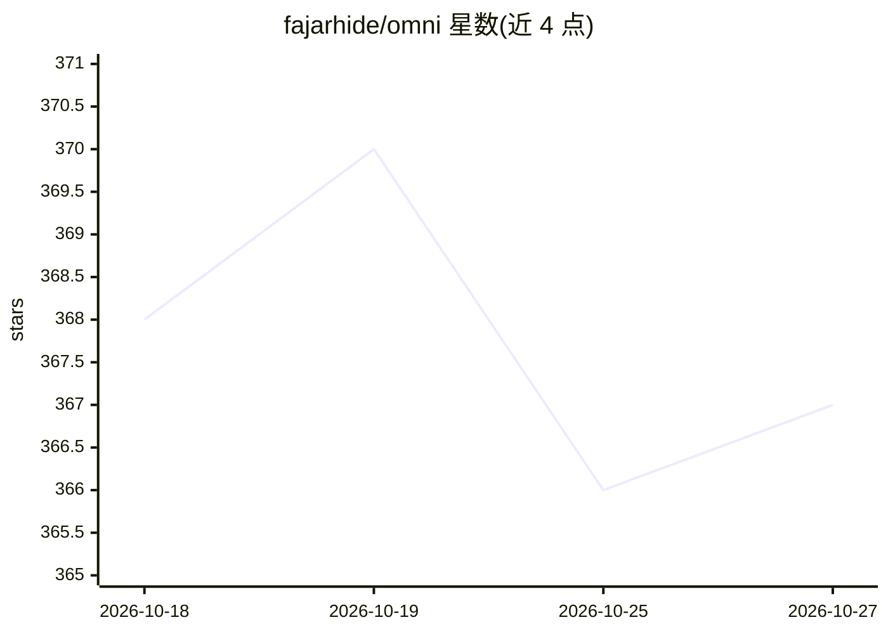

# fajarhide/omni

⭐ 367 · Rust · Apache-2.0 · 推送 2026-10-23 · [GitHub](https://github.com/fajarhide/omni) · [官网](https://omni.weekndlabs.com/docs) · 个人维护 · 中文 README

**为编码 agent 压缩命令输出的上下文蒸馏工具**

以两个钩子包裹 agent 的工具调用：pre-hook 在命令前，post-hook 在模型读取前蒸馏输出——过滤构建日志、层哈希、进度条等噪声，把 agent 已看过的重复内容折叠为带检索句柄的标记，被裁剪的字节归档到本地 SQLite，可用 omni retrieve 逐字节取回。失败命令原样透传，JSON/YAML/CSV 不做改动。按宿主能力分三档接入：Claude Code、Codex CLI、Gemini CLI 等可完整重写输出；Cursor、Windsurf 走 omni_run；Cline、VS Code、Copilot 等仅通过 MCP 提供 omni_run。跨会话记忆分永久/30 天/7 天三层保留。以 Rust 实现，经 Homebrew、curl 脚本、PowerShell 或 Claude Code 插件市场安装。

## 筛选速览

| 维度 | 判定 | 备注 |
|---|---|---|
| AI 角色 | `ai-ecosystem` | LLM/agent 周边工具 |
| 许可风险 | `permissive` | Apache-2.0 |
| 部署形态 | `self-host` | docker 或自建部署 |
| 模型依赖 | — | README 未给出锁定关系 |
| 硬件要求 | — | 无带数字的原话,不猜 |
| 安装摩擦 | `low` | 无编译、无系统依赖或容器化 |
| 成熟度 | — | 结构信号不足 |

## 能力要点

- 重复读取的输出折叠为标记+句柄，第二次读取节省 97.2%
- 被删内容归档本地 SQLite，omni retrieve 逐字节还原
- 失败命令原样透传，JSON/YAML/NDJSON/CSV 不改动
- 按宿主能力分 Full / Handoff-first / MCP-only 三档接入

## 适用场景

- 降低编码 agent 会话中重复文件读取和命令输出的 token 开销
- 让 Cursor、Cline 等无法重写内置工具输出的宿主经 omni_run 走蒸馏路径
- 跨会话保留项目知识与错误模式记忆

## 场景标签

`Agent 记忆` · 领域:Agent 开发

## 证据(README 行号)

> L41: OMNI runs as two hooks around a tool call: a pre-hook before the command, a post-hook that distills the output befo
> L125: |Tier|Hosts|What you get|

## 星数曲线

2026-10-18 368 → 2026-10-27 367（-1）

---
*卡片 v1 · prompt 1.4 · 生成 2026-10-22 · 置信度 mid · 依据 README sha `3e751019cfdf` · [字段定义](../../DATASET.md)*
