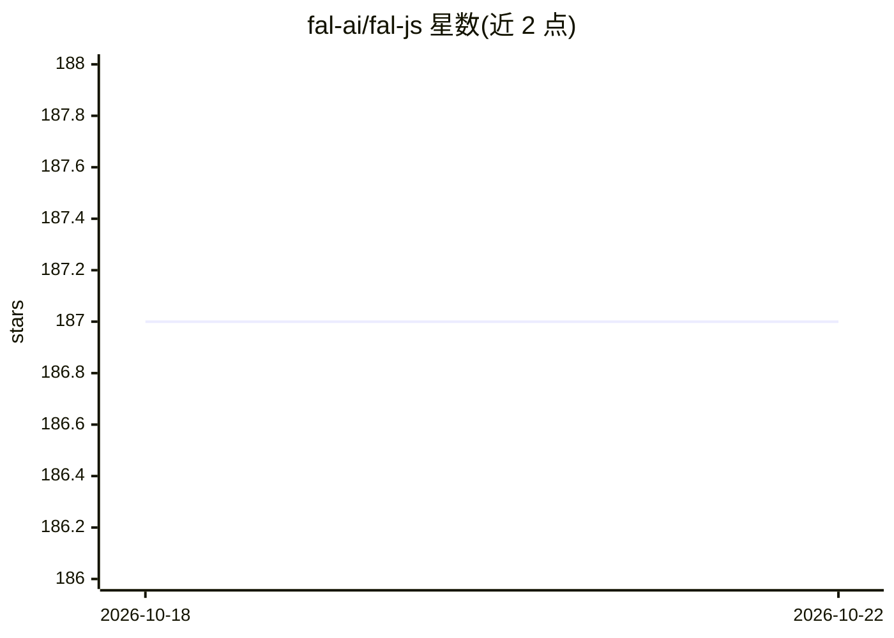

# fal-ai/fal-js

⭐ 187 · TypeScript · MIT · 推送 2026-10-16 · [GitHub](https://github.com/fal-ai/fal-js) · [官网](https://fal.ai) · 组织维护

**面向开发者的 fal.ai 模型服务 JavaScript/TypeScript 客户端库**

由 fal.ai 维护的 JS/TS 客户端库，包含 @fal-ai/client 与 @fal-ai/server-proxy 两个 npm 包。client 作为 fal 平台端点的调用层，基于 fetch 等平台标准构建，支持 Web、Node.js 与 React Native 环境，以 fal.run 执行远程函数并返回类型化结果；server-proxy 为 Next.js 等常见框架提供即插即用的代理函数，避免在客户端代码中暴露 FAL_KEY 凭据。提供 Next.js 示例应用（page-router 与 app-router 版本）。

## 筛选速览

| 维度 | 判定 | 备注 |
|---|---|---|
| AI 角色 | `ai-ecosystem` | LLM/agent 周边工具 |
| 许可风险 | `permissive` | MIT |
| 部署形态 | `library` | 以包/库形式分发 |
| 模型依赖 | — | README 未给出锁定关系 |
| 硬件要求 | — | 无带数字的原话,不猜 |
| 安装摩擦 | `low` | 无编译、无系统依赖或容器化 |
| 成熟度 | — | 结构信号不足 |

## 能力要点

- TypeScript 编写，端点调用结果带类型映射
- 跨 Web/Node.js/React Native 运行时工作
- server-proxy 支持 Next.js 等框架的凭据代理方案

## 适用场景

- 在 Next.js 应用中调用 fal.ai 托管的模型端点
- 通过服务端代理保护 FAL_KEY 凭据
- 在 React Native 应用中接入 fal 平台

## 场景标签

 · 领域:AI 平台客户端/开发工具

## 证据(README 行号)

> L10: The fal JavaScript/TypeScript Client is a robust and user-friendly library designed for seamless integration of fal
> L14: The `@fal-ai/client` library serves as a client for fal apps hosted on fal. For guidance on consuming and creating 

## 星数曲线

2026-10-18 187 → 2026-10-22 187（+0）

---
*卡片 v1 · prompt 1.4 · 生成 2026-10-22 · 置信度 high · 依据 README sha `ae24f27ae10e` · [字段定义](../../DATASET.md)*
