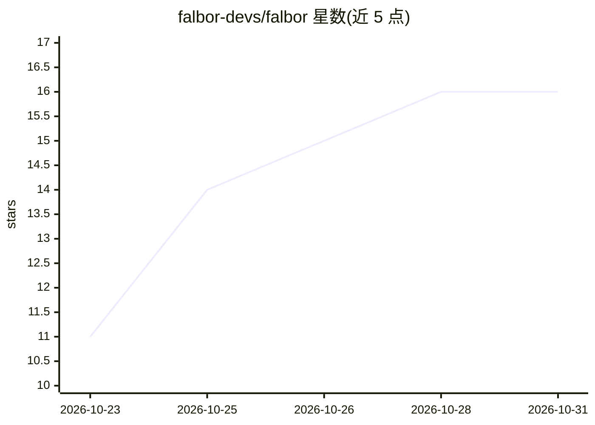

# falbor-devs/falbor

⭐ 16 · TypeScript · NOASSERTION · 推送 2026-10-24 · [GitHub](https://github.com/falbor-devs/falbor) · [官网](https://falbor.xyz) · 组织维护

**开源 AI 营销平台：竞品分析与增长自动化**

面向开发者、创始人与增长团队的开源 AI 营销平台（Next.js + React + TypeScript），功能包括竞品分析、市场趋势追踪与增长自动化。集成三类 AI 提供商：OpenAI 用于通用助手，Anthropic 用于执行市场调研与竞品分析的自主 agent，DeepSeek 用于 agent 的备选分析路径。本地运行需配置 PostgreSQL（Neon）与 Drizzle ORM，通过 npm 安装并启动开发服务器，运行 AI 功能需配置相应 API key。采用 MIT 许可证。

## 筛选速览

| 维度 | 判定 | 备注 |
|---|---|---|
| AI 角色 | `ai-native` | 本体是模型或模型工具 |
| 许可风险 | `none` | NOASSERTION |
| 部署形态 | `library` | 以包/库形式分发 |
| 模型依赖 | — | README 未给出锁定关系 |
| 硬件要求 | — | 无带数字的原话,不猜 |
| 安装摩擦 | `low` | 无编译、无系统依赖或容器化 |
| 成熟度 | — | 结构信号不足 |

## 能力要点

- 集成 OpenAI / Anthropic / DeepSeek 三类 AI 提供商
- Anthropic 自主 agent 执行市场调研与竞品分析
- 基于 Next.js + PostgreSQL(Neon) + Drizzle ORM 技术栈
- MIT 许可证开源

## 适用场景

- 分析竞争对手并追踪市场趋势
- 用 AI agent 自动化增长相关工作
- 自托管营销平台并保持数据控制权

## 场景标签

`科研工具` `工作流自动化` · 领域:效率与自动化

## 证据(README 行号)

> L6:  Falbor is an Open Source AI Marketing Platform for developers, founders, and growth teams. Analyze competitors, tra
> L84: The project utilizes three AI providers:
> L87: 2. **Anthropic:** For the autonomous AI agents that perform market research and competitor analysis.

## 星数曲线

2026-10-23 11 → 2026-10-31 16（+5）

---
*卡片 v1 · prompt 1.4 · 生成 2026-10-30 · 置信度 high · 依据 README sha `beeff2734c0f` · [字段定义](../../DATASET.md)*
