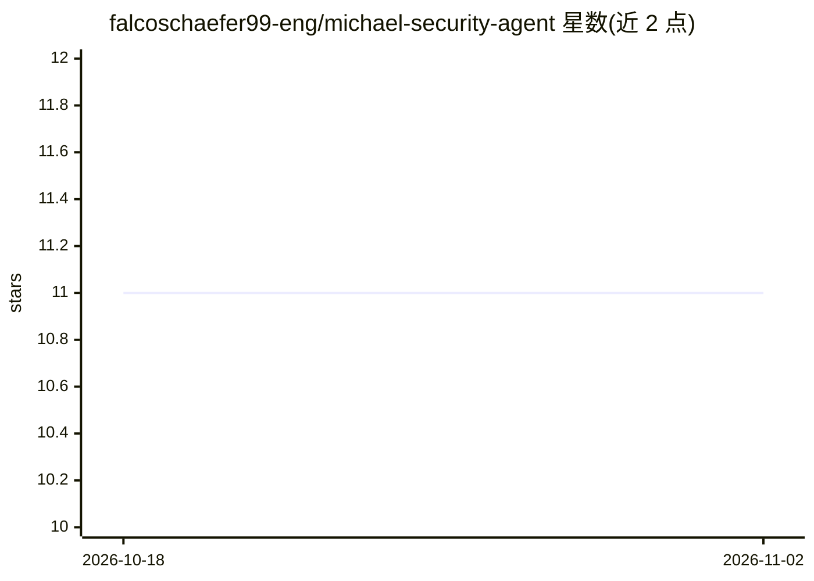

# falcoschaefer99-eng/michael-security-agent

⭐ 11 · Python · Apache-2.0 · 推送 2026-05-23 · [GitHub](https://github.com/falcoschaefer99-eng/michael-security-agent) · 组织维护

**面向 Claude Code 的安全审计 agent，含持久记忆与框架映射**

运行于 Claude Code 的安全专家 agent 定义：对代码库做漏洞诊断，将发现映射到 OWASP Top 10、NIST CSF 2.0 与 STRIDE 等框架，采用只诊断不修补的分工架构（诊断→修复→复审）。内置 46 条来自生产审计的累积经验，通过 SubagentStop 钩子将每次审计的 MEMORY 块持久化到本地文件，可经 git 自动推送或接入 MUSE Brain 跨机同步。提供快速审计、深度审查、事件响应、合规审计四种模式，安装方式为复制 agent 定义与钩子文件到 ~/.claude/ 配置目录。

## 筛选速览

| 维度 | 判定 | 备注 |
|---|---|---|
| AI 角色 | `ai-native` | 本体是模型或模型工具 |
| 许可风险 | `permissive` | Apache-2.0 |
| 部署形态 | `None` |  |
| 模型依赖 | locked-api |  |
| 硬件要求 | — | 无带数字的原话,不猜 |
| 安装摩擦 | `low` | 无编译、无系统依赖或容器化 |
| 成熟度 | — | 结构信号不足 |

## 能力要点

- 发现项映射 OWASP Top 10 / NIST CSF 2.0 / STRIDE / Agentic AI Top 10
- SubagentStop 钩子自动收获 MEMORY 块，学习跨审计累积并可跨机同步
- 四种运行模式：快速审计 / 深度审查 / 事件响应 / 合规审计（SOC 2、HIPAA、PCI-DSS、GDPR）
- 只诊断不修补的分工架构与 OpenAPI 测试、CVE 五源富化、SBOM 分析等附加能力

## 适用场景

- 在 Claude Code 工作流中做部署前安全审计与 CI 门禁
- 对新增信任边界做 STRIDE 威胁建模与攻击面梳理
- 让 agent 记住我的代码库历史审计结论，逐次减少误报
- 准备 SOC 2 / HIPAA / PCI-DSS 合规时生成控制映射与差距分析

## 场景标签

`网络安全` `代码审查` · 领域:编码与开发

## 证据(README 行号)

> L19: Michael is a security agent for Claude Code that finds vulnerabilities, maps them to industry frameworks, and tells
> L44: After every review, Michael emits a `MEMORY:` block with new learnings. A SubagentStop hook (`hooks/agent-memory-ha
> L156: Copy the agent definition and supporting files into your Claude Code configuration:

## 星数曲线

2026-10-18 11 → 2026-11-02 11（+0）

---
*卡片 v1 · prompt 1.4 · 生成 2026-11-02 · 置信度 high · 依据 README sha `73637b4949cc` · [字段定义](../../DATASET.md)*
