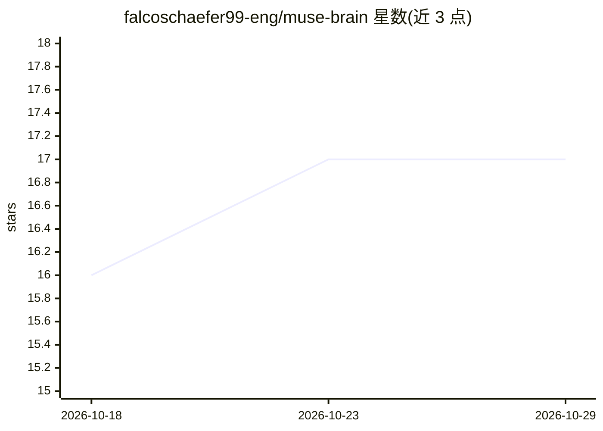

# falcoschaefer99-eng/muse-brain

⭐ 17 · TypeScript · NOASSERTION · 推送 2026-09-27 · [GitHub](https://github.com/falcoschaefer99-eng/muse-brain) · 个人维护

**面向 AI agent 的关系型记忆底座，提供 MCP 工具与自托管持久化**

自托管的 MCP 记忆/运行时底座（MUSE Brain），提供 33 个 MCP 工具与 36 张表，覆盖带情绪质地的记忆记录与混合检索、跨会话持久身份、双 agent 隔离租户（mind_letter 跨租户通信）、六种联想模式的 dream engine、技能评审流水线及任务/唤醒运行时。核心 provider 中立，可选接入 Claude Code/Agent SDK、Codex CLI、Anthropic API key 或本地编排。云端部署需 Cloudflare Workers 与 Neon Postgres，也可用 Node.js 22+ 的 SQLite 本地模式。README 逐项标注 Live/Built/Early 状态，自学习与自主执行尚未形成实际运行记录。含 302 个测试，附带可选 Telegram 与语音（faster-whisper）集成。

## 筛选速览

| 维度 | 判定 | 备注 |
|---|---|---|
| AI 角色 | `ai-ecosystem` | LLM/agent 周边工具 |
| 许可风险 | `none` | NOASSERTION |
| 部署形态 | `None` |  |
| 模型依赖 | locked-api |  |
| 硬件要求 | — | 无带数字的原话,不猜 |
| 安装摩擦 | `low` | 无编译、无系统依赖或容器化 |
| 成熟度 | `idea` | |

## 能力要点

- 33 个 MCP 工具：记忆、身份、关系、联想、通信、自主运行时
- 双 agent 共享单一后端且租户记忆/身份隔离，通过 letters 与委派任务协作
- 云端（Cloudflare Workers + Neon Postgres）与本地 SQLite 两种自托管模式
- README 按 Live/Built/Early 标注各能力实际运行状态

## 适用场景

- 为我的 AI agent 接入跨会话持久记忆与身份
- 搭建双 agent（创作导师 + 陪伴者）共享底座的协作系统
- 自托管 agent 记忆系统，不绑定单一模型厂商

## 场景标签

`Agent 记忆` `多智能体` · 领域:Agent 开发

## 证据(README 行号)

> L76: MUSE Brain's core is provider-neutral: it is an MCP memory/runtime substrate that any capable agent client can use.
> L8:  Provider-neutral MCP core

## 星数曲线

2026-10-18 16 → 2026-10-29 17（+1）

---
*卡片 v1 · prompt 1.4 · 生成 2026-10-29 · 置信度 high · 依据 README sha `bae71a2cf616` · [字段定义](../../DATASET.md)*
