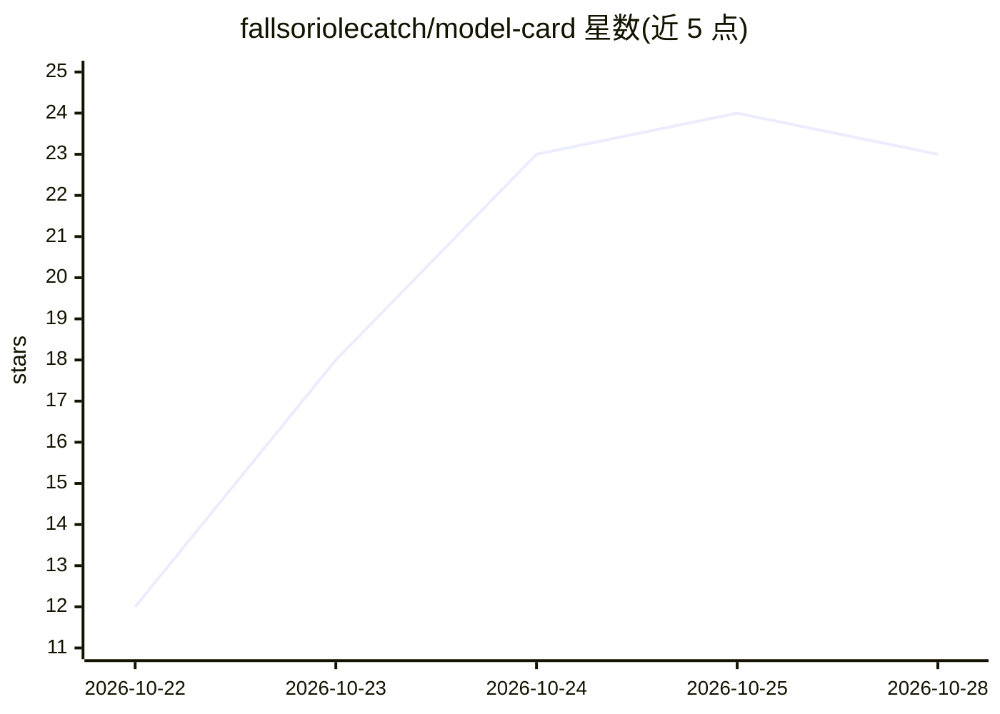

# fallsoriolecatch/model-card

⭐ 23 · C# · MIT · 推送 2026-10-18 · [GitHub](https://github.com/fallsoriolecatch/model-card) · 个人维护

**Windows 桌面工具：为 LLM 生成 Hugging Face 格式模型卡**

面向模型发布者的表单向导式模型卡生成器（C#/.NET 8）：填写模型名、基座模型、许可证等字段后生成 Hugging Face 布局的 Markdown 卡片，支持实时预览与导出；可从 GGUF 文件自动读取参数量、上下文长度和量化信息，内置基准分数表构建器与许可证文本助手，模板片段可复用。提供 100 MB 自包含便携 exe（Windows 10/11 x64，离线运行，含 SHA-256 校验），也可用 .NET 8 SDK 自行构建。下载链接以带密码的压缩包形式给出。

## 筛选速览

| 维度 | 判定 | 备注 |
|---|---|---|
| AI 角色 | `ai-ecosystem` | LLM/agent 周边工具 |
| 许可风险 | `permissive` | MIT |
| 部署形态 | `None` |  |
| 模型依赖 | — | README 未给出锁定关系 |
| 硬件要求 | — | 无带数字的原话,不猜 |
| 安装摩擦 | `medium` | 含编译或系统依赖之一 |
| 成熟度 | — | 结构信号不足 |

## 能力要点

- 表单向导生成 Hugging Face 布局的完整模型卡
- 从 GGUF 文件自动读取参数量、上下文长度与量化信息
- 基准分数表构建器与许可证文本助手
- 100 MB 自包含便携 exe，离线运行并附 SHA-256 校验

## 适用场景

- 为微调或量化后的 LLM 编写发布用模型卡
- 从 GGUF 文件提取元数据避免手工誊抄参数
- 维护多个模型发布时复用自定义模板片段

## 场景标签

 · 领域:LLM 文档/发布工具

## 证据(README 行号)

> L3: 🏷️ Free, open-source model card generator for Windows — auto-fill metadata, benchmark tables, license text into clea
> L12: - ✅ **Auto-detect from GGUF** — parameter count, context length and quantization pulled straight out of the file
> L65: dotnet publish -c Release -r win-x64 --self-contained -p:PublishSingleFile=true

## 星数曲线

2026-10-22 12 → 2026-10-28 23（+11）

---
*卡片 v1 · prompt 1.4 · 生成 2026-10-27 · 置信度 high · 依据 README sha `4e337ff0ecf2` · [字段定义](../../DATASET.md)*
