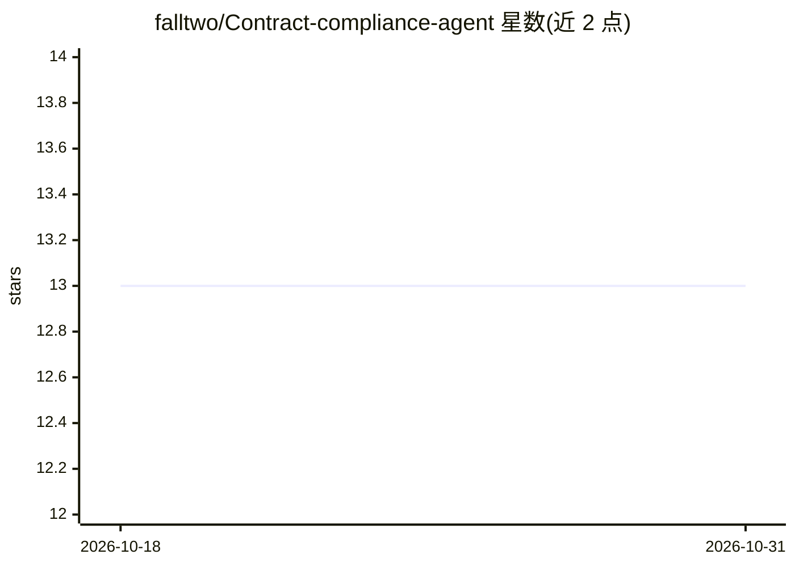

# falltwo/Contract-compliance-agent

⭐ 13 · Python · MIT · 推送 2026-10-11 · [GitHub](https://github.com/falltwo/Contract-compliance-agent) · 组织维护 · 中文 README

**繁中合約初審工具：標出風險條款並附台灣法條出處**

上傳 PDF/DOCX/TXT/MD 合約後，系統產出結構化風險卡片：原文引述、風險等級、法條依據（連司法院／全國法規資料庫）與修改建議。機制上採規則意圖分流＋LLM 路由、向量（Pinecone）＋BM25（jieba 分詞、內建 60 個法律術語）混合檢索以 RRF 合併，審閱拆成調查員／判官兩段 prompt，並有每次查詢 12 次 LLM 呼叫上限。支援 Gemini 或本機 Ollama，提供 Streamlit、FastAPI+Vue 版本與評測集；README 聲明輸出非法律意見，須人工複核。2026 經濟部智慧創新大賞入圍。

## 筛选速览

| 维度 | 判定 | 备注 |
|---|---|---|
| AI 角色 | `ai-native` | 本体是模型或模型工具 |
| 许可风险 | `permissive` | MIT |
| 部署形态 | `None` |  |
| 模型依赖 | local-ok | 支持本地模型 |
| 硬件要求 | — | 无带数字的原话,不猜 |
| 安装摩擦 | `low` | 无编译、无系统依赖或容器化 |
| 成熟度 | — | 结构信号不足 |

## 能力要点

- 風險卡片含原文引述、風險等級、法條連結與修改建議
- 規則分流＋LLM 路由，意圖明確請求不呼叫 LLM
- Pinecone 向量＋BM25（jieba 法律術語辭典）混合檢索，RRF 合併
- 調查員／判官兩段式審閱 prompt 與單次查詢 12 次 LLM 呼叫上限

## 适用场景

- 上傳合約做第一輪風險條款審閱並取得修改建議
- 查詢台灣法條條文與合約知識庫問答
- 全本機（Ollama）環境下執行合約審閱流程

## 场景标签

`RAG` `文档问答` · 领域:知识与检索

## 证据(README 行号)

> L3: > 上傳一份合約，系統會標出高風險條款，附上修改建議和法條出處。這是幫人做第一輪審閱的工具，最後仍要由人判斷。
> L14: 合約初審最花時間的，是逐條讀完、再一條條查法條。這個專案把兩件事接起來：先從合約找出有風險的條款，再到司法院和全國法規資料庫查對應條文，最後產出風險卡片，每張都標明引用合約哪一段、依據哪一條法律。
> L24: 系統回傳結構化的風險卡片，每張包含：

## 星数曲线

2026-10-18 13 → 2026-10-31 13（+0）

---
*卡片 v1 · prompt 1.4 · 生成 2026-10-31 · 置信度 high · 依据 README sha `f453530d9f87` · [字段定义](../../DATASET.md)*
