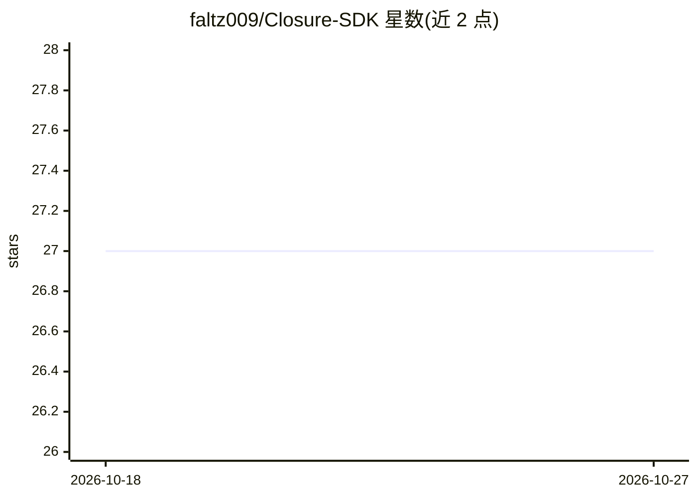

# faltz009/Closure-SDK

⭐ 27 · Rust · AGPL-3.0 · 推送 2026-10-19 · [GitHub](https://github.com/faltz009/Closure-SDK) · [官网](https://faltz009.github.io/Closure-SDK/) · 个人维护

**用四元数旋转几何比对两条记录流，找出缺失/移动/变更**

Rust 编写的流对账 SDK 与 CLI：将每条记录映射为单位四元数，按顺序做哈密顿积得到 32 字节定长摘要；两条流不一致时通过二分搜索与双指针线性扫描（Gilgamesh）逐条定位缺失、移动、变更记录，输出 JSON 报告并在文件不同时以状态码 2 退出。支持 JSONL/CSV/文本文件、命名管道与 stdin，提供三条 CLI 命令与 Rust 库 API，面向数据管道、导出与副本的对账场景，采用 AGPL-3.0-only 许可。

## 筛选速览

| 维度 | 判定 | 备注 |
|---|---|---|
| AI 角色 | `ai-enhanced` | 去掉 AI 部分产品仍成立 |
| 许可风险 | `viral` | AGPL-3.0 |
| 部署形态 | `library` | 以包/库形式分发 |
| 模型依赖 | — | README 未给出锁定关系 |
| 硬件要求 | — | 无带数字的原话,不猜 |
| 安装摩擦 | `low` | 无编译、无系统依赖或容器化 |
| 成熟度 | — | 结构信号不足 |

## 能力要点

- 基于 S³ 四元数积的定长（32 字节）流摘要
- 精确区分 missing/moved/changed 三类差异并输出报告
- 支持文件、命名管道与 stdin 的三种 CLI 模式（identity/observer/seeker）
- 提供 Rust 库 API（gilgamesh、Seer）与可运行示例

## 适用场景

- 对账数据管道两侧输出，找出缺失与错位记录
- 比对数据库导出与副本文件是否一致
- 监听两条实时流并在摘要分歧时诊断差异

## 场景标签

 · 领域:数据管道/数据完整性

## 证据(README 行号)

> L13: `closure identity` lists every missing and moved record with its position in
> L19: Every record becomes a rotation, a unit quaternion on the three-sphere S³, and

## 星数曲线

2026-10-18 27 → 2026-10-27 27（+0）

---
*卡片 v1 · prompt 1.4 · 生成 2026-10-26 · 置信度 low · 依据 README sha `95ded519c9fb` · [字段定义](../../DATASET.md)*
