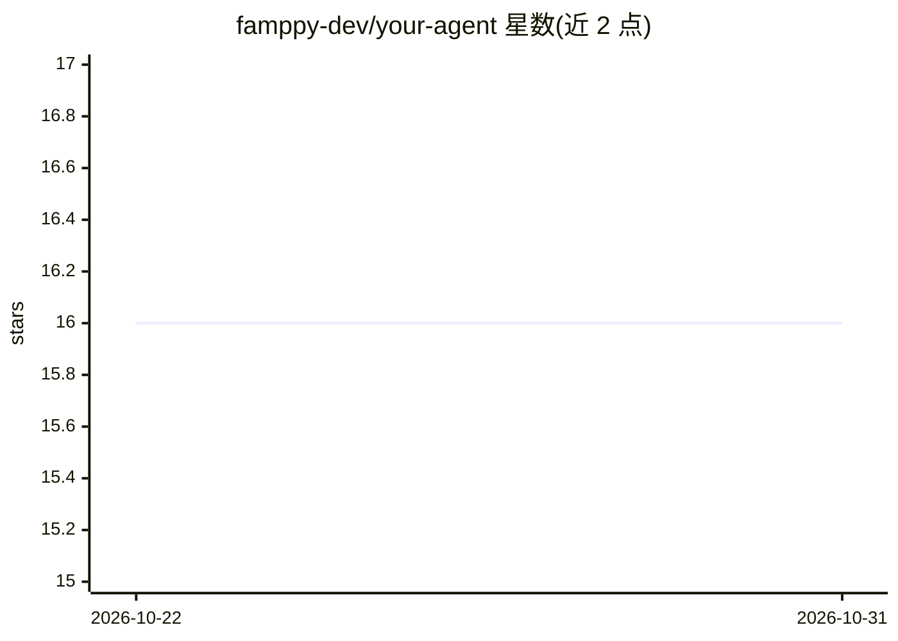

# famppy-dev/your-agent

⭐ 16 · Python · BSD-3-Clause · 推送 2026-01-19 · [GitHub](https://github.com/famppy-dev/your-agent) · 组织维护

**多模态 RAG 引擎：vLLM 推理+Milvus 存储，文本图像检索问答**

以 Docker Compose 部署的多模态检索增强生成（RAG）框架：集成 vLLM Async Engine 做推理、Milvus 做向量存储，支持语义分块、重排序、VLM 图像描述索引，并可从文本抽取实体与关系做 Graph-RAG 结构化检索。通过 OpenAI 兼容的 HTTP API 提供 RAG 问答、文本/文件嵌入与检索接口，模型可经环境变量切换。要求 NVIDIA Ampere 及以上 GPU、CUDA 12.4 驱动与 Docker。

## 筛选速览

| 维度 | 判定 | 备注 |
|---|---|---|
| AI 角色 | `ai-ecosystem` | LLM/agent 周边工具 |
| 许可风险 | `permissive` | BSD-3-Clause |
| 部署形态 | `self-host` | docker 或自建部署 |
| 模型依赖 | local-ok | 支持本地模型 |
| 硬件要求 | — | 无带数字的原话,不猜 |
| 安装摩擦 | `low` | 无编译、无系统依赖或容器化 |
| 成熟度 | — | 结构信号不足 |

## 能力要点

- vLLM Async Engine 推理与 Milvus 向量存储的集成
- 语义分块与 Reranker 的检索管线
- VLM 图像描述索引，支持图文混合检索
- 实体/关系抽取实现 Graph-RAG 结构化检索

## 适用场景

- 搭建本地文档知识库并进行有出处的问答
- 对含图像的 PDF 等文档做多模态索引与检索
- 通过 OpenAI 兼容 API 将 RAG 能力接入自有应用

## 场景标签

`RAG` `多模态` · 领域:知识与检索

## 证据(README 行号)

> L3: This project is a high-performance, **multi-modal Retrieval-Augmented Generation (RAG)** framework. By integrating *
> L17: - **High-Performance Inference:** Delivers low-latency responses and high throughput powered by the vLLM Async Engi
> L53: ### Basic call (OpenAI Compatible)

## 星数曲线

2026-10-22 16 → 2026-10-31 16（+0）

---
*卡片 v1 · prompt 1.4 · 生成 2026-10-30 · 置信度 high · 依据 README sha `6a5cef3a929e` · [字段定义](../../DATASET.md)*
