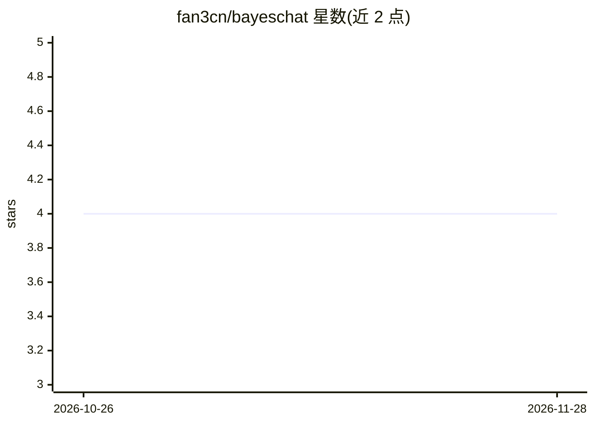

# fan3cn/bayeschat

⭐ 4 · JavaScript · 推送 2026-11-22 · [GitHub](https://github.com/fan3cn/bayeschat) · [官网](https://bayeschat.xyz) · 个人维护 · 中文 README

**iOS/iPadOS 隐私 AI 聊天客户端：BYOK、MCP、记忆与预设**

运行在 iPhone 与 iPad 上的 BYOK 聊天客户端：指向用户自有的模型服务（OpenAI、Anthropic、Gemini、OpenRouter 及任意 OpenAI 兼容端点、Ollama 等本地运行时），密钥存于 Keychain。功能包括远程 MCP 服务器接入（Streamable HTTP）、可切换的完整配置预设、跨会话记忆（可见可编辑可删除）、后台继续运行（Live Activity/Dynamic Island）、Markdown/KaTeX 渲染与批量导出。需 iOS/iPadOS 17+，仅支持远程 MCP；App Store 分发，Pro 为一次性 $14.99 购买。

## 筛选速览

| 维度 | 判定 | 备注 |
|---|---|---|
| AI 角色 | `ai-native` | 本体是模型或模型工具 |
| 许可风险 | `none` | — |
| 部署形态 | `None` |  |
| 模型依赖 | local-ok | 支持本地模型 |
| 硬件要求 | — | 无带数字的原话,不猜 |
| 安装摩擦 | `low` | 无编译、无系统依赖或容器化 |
| 成熟度 | — | 结构信号不足 |

## 能力要点

- BYOK 多协议接入：Chat Completions、Anthropic Messages、Responses API 及 OpenAI 兼容端点
- 远程 MCP 服务器工具调用内联渲染，支持并发、重试与逐工具开关
- 预设保存完整任务配置（提示词/模型/参数/记忆/工具）一键切换
- 密钥与数据全部本地存储，无账号无追踪

## 适用场景

- 在 iPhone/iPad 上使用自有 API key 与多家模型服务对话
- 移动端接入远程 MCP 服务器执行工具调用
- 为翻译、研究等不同任务保存一键切换的聊天配置
- 本地运行 Ollama/LM Studio/llama.cpp 作为聊天后端

## 场景标签

`聊天机器人` · 领域:对话与助手

## 证据(README 行号)

> L5:  Private iOS AI chat: BYOK, MCP, memory and presets — all on your device.
> L48: - **OpenAI** (Chat Completions and the Responses API), **Anthropic** (Messages),
> L81: Most MCP tooling stops at the desktop. BayesChat connects to **remote MCP servers

## 星数曲线

2026-10-26 4 → 2026-11-28 4（+0）

---
*卡片 v1 · prompt 1.4 · 生成 2026-11-21 · 置信度 high · 依据 README sha `cca12ef36ffc` · [字段定义](../../DATASET.md)*
