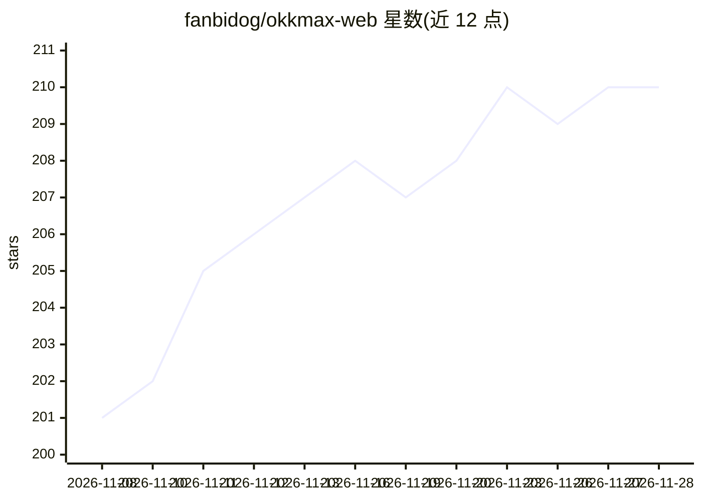

# fanbidog/okkmax-web

⭐ 210 · TypeScript · NOASSERTION · 推送 2026-11-23 · [GitHub](https://github.com/fanbidog/okkmax-web) · [官网](https://www.okkmax.com) · 组织维护 · 中文 README

**AI API 中转站测评与排行榜：选站前核验真伪与可用性**

独立第三方的 AI API 中转站测评与导航平台，覆盖站点排行、纯度检测、可用性监测、模型智商榜与口碑社区。机器轨道用被测站自己的账号定时探测，真伪验证基于 Anthropic 思维签名，检测报告页公开可访问；用户口碑轨道提供评分与优缺点标签。平台不收取影响排名的费用，不保存自测用的 API Key。仓库为 Next.js + Prisma + PostgreSQL 的网站与数据展示层，完整测评平台还需另接检测后端与可用性监测组件。

## 筛选速览

| 维度 | 判定 | 备注 |
|---|---|---|
| AI 角色 | `ai-knowledge` | 知识聚合/清单类 |
| 许可风险 | `none` | NOASSERTION |
| 部署形态 | `library` | 以包/库形式分发 |
| 模型依赖 | — | README 未给出锁定关系 |
| 硬件要求 | — | 无带数字的原话,不猜 |
| 安装摩擦 | `low` | 无编译、无系统依赖或容器化 |
| 成熟度 | — | 结构信号不足 |

## 能力要点

- 纯度检测：基于思维签名的真伪验证，三档判定并生成公开报告页
- 可用性监测：分钟级探测，输出 90 分钟至 30 天在线率与延迟趋势
- MCP 服务提供 6 个只读工具，另有 Skills 与 llms.txt 文本入口
- 榜单分数来自自动探针，判定方法公开

## 适用场景

- 选 Claude/GPT/Gemini 中转站前对比纯度、价格与在线率
- 怀疑被降智时核实站点是否偷换模型
- 让 Claude Code、Codex、Cursor 通过 MCP 直接查询测评数据
- 自部署一套中转站测评展示平台

## 场景标签

`模型评测` · 领域:评测与运维

## 证据(README 行号)

> L14: 独立第三方的 AI API 中转站测评与导航平台。
> L15: 榜单分数全部来自自动探针，判定方法公开可审计，不收取任何影响排名的费用。
> L57: |Agent 接入|让 AI Agent 通过 MCP、Skills 和 llms.txt 直接查询测评数据|开发者与 AI Agent 接入|

## 星数曲线

2026-11-08 201 → 2026-11-28 210（+9）

---
*卡片 v1 · prompt 1.4 · 生成 2026-11-25 · 置信度 mid · 依据 README sha `409990a1b21d` · [字段定义](../../DATASET.md)*
