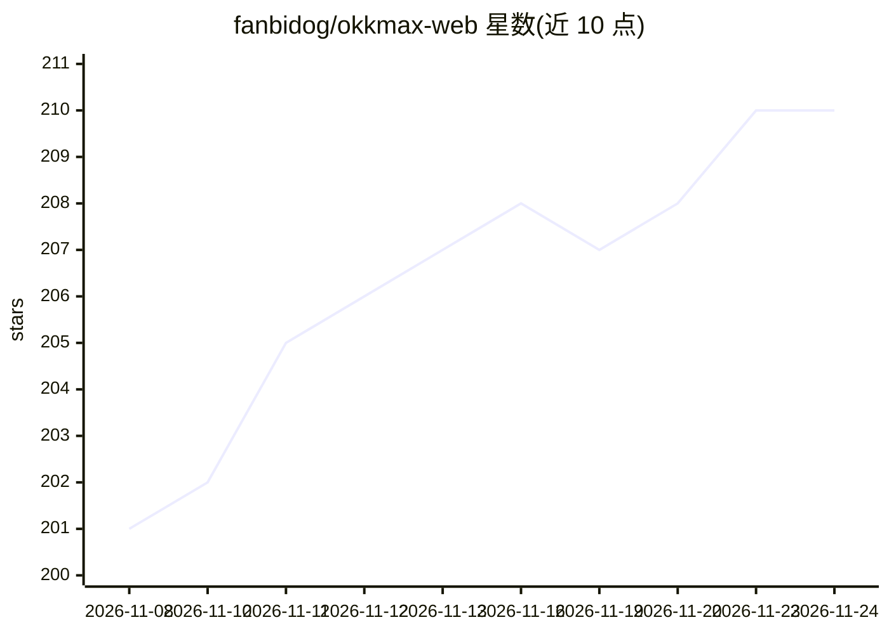

# fanbidog/okkmax-web

⭐ 210 · TypeScript · NOASSERTION · 推送 2026-11-23 · [GitHub](https://github.com/fanbidog/okkmax-web) · [官网](https://www.okkmax.com) · 个人维护 · 中文 README

**AI API 中转站测评与排行榜平台，检测纯度与可用性**

独立第三方 Web 平台（Next.js 16 全栈 + Prisma + PostgreSQL），对 Claude、GPT、Gemini 中转站做纯度检测（Claude 基于 Anthropic 思维签名三档判定）、分钟级可用性监测、价格与模型覆盖对比、模型智商榜及用户口碑社区。数据来自自动探针，判定方法公开。同时以 MCP（6 个只读工具）、Skills 和 llms.txt 向 AI Agent 开放只读查询。本仓库仅为展示层，完整测评还需检测后端与监测采集组件；采用非商业许可，可自部署（Node.js 20+、PostgreSQL）。

## 筛选速览

| 维度 | 判定 | 备注 |
|---|---|---|
| AI 角色 | `ai-ecosystem` | LLM/agent 周边工具 |
| 许可风险 | `none` | NOASSERTION |
| 部署形态 | `library` | 以包/库形式分发 |
| 模型依赖 | — | README 未给出锁定关系 |
| 硬件要求 | — | 无带数字的原话,不猜 |
| 安装摩擦 | `low` | 无编译、无系统依赖或容器化 |
| 成熟度 | — | 结构信号不足 |

## 能力要点

- 基于 Anthropic 思维签名的 Claude 纯度三档判定，检测报告公开可访问
- 90 分钟至 30 天多窗口在线率与延迟监测
- MCP 服务提供 6 个只读工具，另有 Skills 与 llms.txt 接入
- 自带 Key 自测：Key 用完即弃，不落库不留日志

## 适用场景

- 买中转站前核实是否跑的真模型、比价与看在线率
- 怀疑被降智偷换时做纯度检测
- 让 Claude Code/Cursor 里的 Agent 直接查询中转站数据
- 站主提交收录并跟踪自家站点档位变化

## 场景标签

`模型评测` · 领域:评测与运维

## 证据(README 行号)

> L51: |可用性监测|各站各分组持续探测，查看 90 分钟、24 小时、7 天、30 天的在线率与延迟趋势|可用性监测|
> L111: - 地址：`https://www.okkmax.com/mcp`（Streamable HTTP，无需认证）

## 星数曲线

2026-11-08 201 → 2026-11-24 210（+9）

---
*卡片 v1 · prompt 1.4 · 生成 2026-11-17 · 置信度 high · 依据 README sha `9b5edf9504a2` · [字段定义](../../DATASET.md)*
