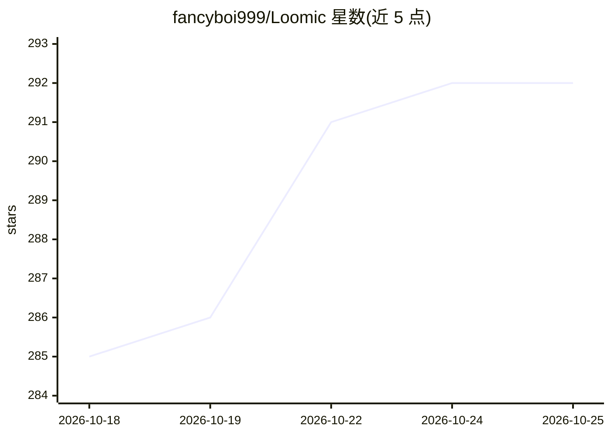

# fancyboi999/Loomic

⭐ 292 · TypeScript · MIT · 推送 2026-09-30 · [GitHub](https://github.com/fancyboi999/Loomic) · [官网](https://loomic-one.vercel.app) · 个人维护 · 中文 README

**开源 AI 画布设计 Agent：对话生成图片与视频**

面向创作者的开源 AI 创作工作台：在基于 Excalidraw 的无限画布上与 Agent 对话，由 LangGraph 驱动的 Agent 调用 Google Gemini / Vertex AI / OpenAI / Replicate 等十余个模型直接生成图片与视频，素材自动落在画布上，支持多轮对话迭代、Brand Kit 品牌规范遵循、Markdown 技能扩展、积分计费与 LemonSqueezy 订阅。技术栈为 Next.js + Fastify + Supabase + Turborepo monorepo，需自备 Supabase 项目和至少一个 AI API key，从源码部署运行，README 自述为 Lovart / CapCut Video Studio / Canva AI 的开源替代。

## 筛选速览

| 维度 | 判定 | 备注 |
|---|---|---|
| AI 角色 | `ai-native` | 本体是模型或模型工具 |
| 许可风险 | `permissive` | MIT |
| 部署形态 | `self-host` | docker 或自建部署 |
| 模型依赖 | — | README 未给出锁定关系 |
| 硬件要求 | — | 无带数字的原话,不猜 |
| 安装摩擦 | `low` | 无编译、无系统依赖或容器化 |
| 成熟度 | — | 结构信号不足 |

## 能力要点

- 对话式无限画布：Agent 理解画布上下文，生成图片/视频并自动排版
- 接入 15+ 图片模型（Imagen 4、DALL-E 3、Flux Kontext 等）与多家视频模型（Veo 3.1、Kling、Sora 2 等）
- Brand Kit 品牌色/字体/Logo 设定，AI 生成自动遵循
- 内置积分系统与 LemonSqueezy 订阅集成，自部署可用种子脚本免接支付

## 适用场景

- 在无限画布上通过对话完成从构思、故事板到导出的设计流程
- 自部署一个数据自主可控的 AI 图片/视频生成工作台
- 团队按品牌规范批量生成设计素材

## 场景标签

`图像生成` `视频生成` · 领域:内容生成

## 证据(README 行号)

> L27: Loomic 做的是同一件事，但完全开源。你在无限画布上跟 AI 对话，它直接生成图片、视频，摆好位置，调好样式。不需要时间轴，不需要模板，不需要学 prompt 工程。说"把左边那张换成暖色调"，AI 就懂了。
> L29: 从构思、角色设定、故事板、场景生成、细节打磨到导出——整个创作流程在一个画布上完成。底层是 LangGraph 驱动的 Agent，接了 Google Gemini / Vertex AI / OpenAI / Replicate

## 星数曲线

2026-10-18 285 → 2026-10-25 292（+7）

---
*卡片 v1 · prompt 1.4 · 生成 2026-10-22 · 置信度 mid · 依据 README sha `72f521b2e90a` · [字段定义](../../DATASET.md)*
