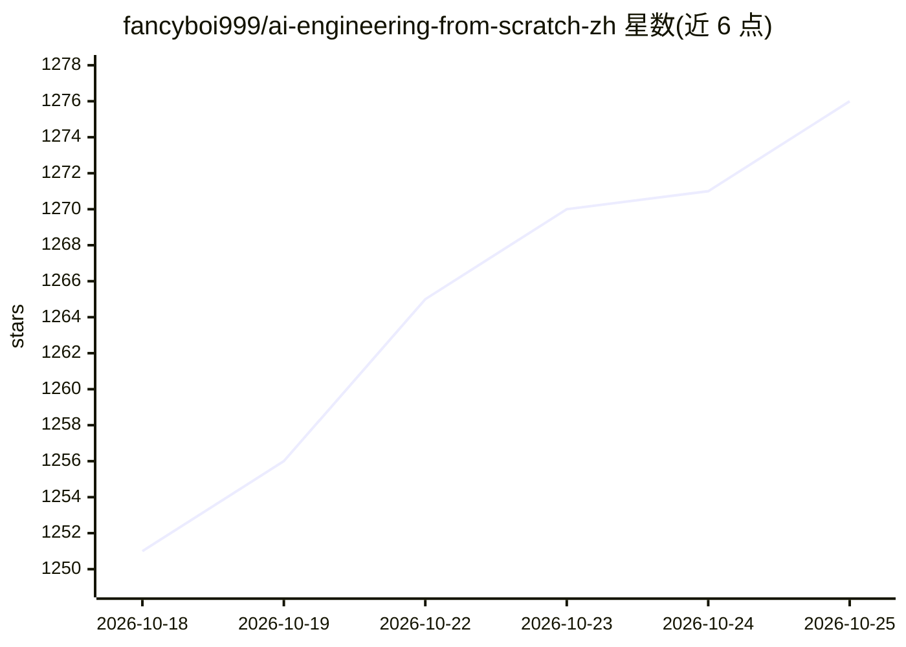

# fancyboi999/ai-engineering-from-scratch-zh

⭐ 1,276 · Python · MIT · 推送 2026-10-21 · [GitHub](https://github.com/fancyboi999/ai-engineering-from-scratch-zh) · [官网](https://aieng-zh.cn) · 个人维护 · 中文 README

**AI 工程中文全量课程：542 课 20 阶段，从数学手写到 agent**

AI Engineering from Scratch 的简体中文衍生版，提供 542 节课、20 个阶段的系统化 AI 工程课程，覆盖 Python/TypeScript/Rust/Julia 四种语言，从线性代数、经典机器学习到 LLM 工程、MCP 与自主 agent。每节课含中文正文、可运行代码、测验与可复用产物；配套独立中文网站、333 节配音动画视频和 9 个可安装到 Claude Code/Codex 等宿主的 AI 导师技能（定位、教学、测验）。另有 78 项实战项目与 Claude/MCPA 认证备考路线，声明独立于 Anthropic 与 Linux Foundation。

## 筛选速览

| 维度 | 判定 | 备注 |
|---|---|---|
| AI 角色 | `ai-knowledge` | 知识聚合/清单类 |
| 许可风险 | `permissive` | MIT |
| 部署形态 | `library` | 以包/库形式分发 |
| 模型依赖 | — | README 未给出锁定关系 |
| 硬件要求 | — | 无带数字的原话,不猜 |
| 安装摩擦 | `low` | 无编译、无系统依赖或容器化 |
| 成熟度 | — | 结构信号不足 |

## 能力要点

- 542 节课、20 个阶段，四种语言从零手写实现算法
- 配套中文网站 aieng-zh.cn 与 333 节中文配音动画
- 9 个内置 AI 导师技能，可经 npx skills 安装到兼容宿主
- 每节课产出可复用技能/prompt/MCP server，含 78 项实战项目

## 适用场景

- 系统自学 AI 工程，从数学基础到 agent 与生产部署
- 在 Claude Code/Codex 中用 AI 导师技能按计划逐课学习
- 备考 Claude 官方认证或 MCPA 认证
- 通过实战项目练手 RAG 评估、agent 调试等工程能力

## 场景标签

`教程课程` · 领域:学习与行业

## 证据(README 行号)

> L18: > 542 节课，20 个阶段，覆盖 Python、TypeScript、Rust、Julia。课程配有中文正文、测验、
> L23: > 本项目是 AI Engineering from Scratch（作者 Rohit Ghumare，MIT 协议）的**简体中文衍生版**。衷心感谢原作者创作并开源了这套课程。
> L181: 这套课程就是那根脊椎。20 个阶段，542 节课，四种语言：Python、TypeScript、Rust、Julia。

## 星数曲线

2026-10-18 1,251 → 2026-10-25 1,276（+25）

---
*卡片 v1 · prompt 1.4 · 生成 2026-10-21 · 置信度 high · 依据 README sha `7cf7d133e93a` · [字段定义](../../DATASET.md)*
