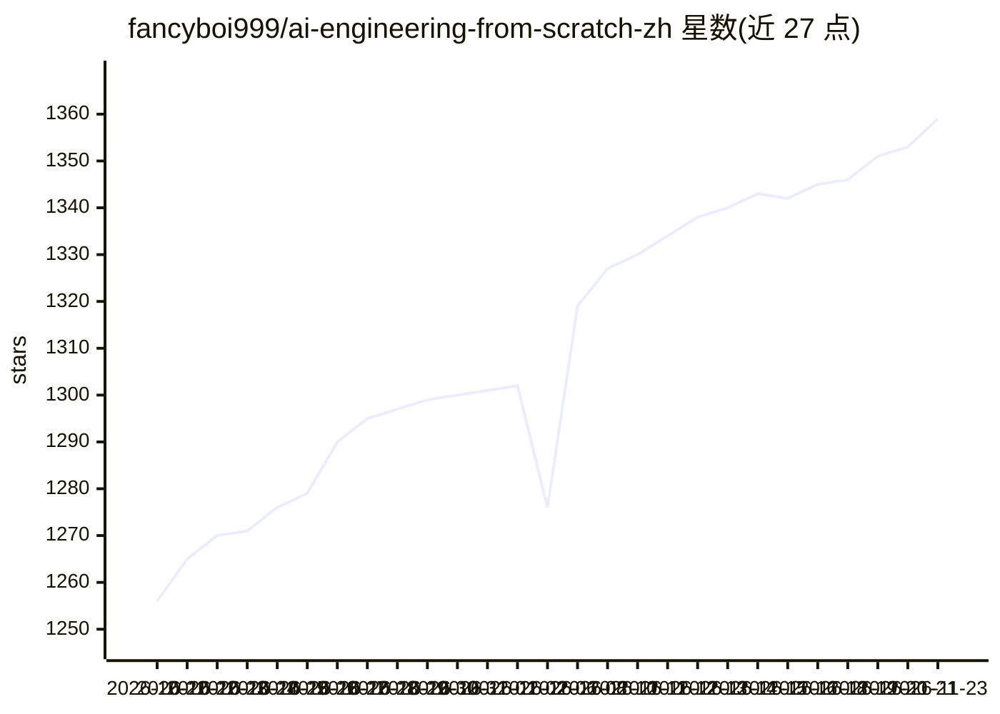

# fancyboi999/ai-engineering-from-scratch-zh

⭐ 1,359 · Python · MIT · 推送 2026-11-22 · [GitHub](https://github.com/fancyboi999/ai-engineering-from-scratch-zh) · [官网](https://aieng-zh.cn) · 个人维护 · 中文 README

**AI 工程师中文学习路径：20 阶段 542 课从零构建教程**

Rohit Ghumare 及社区 AI Engineering from Scratch 课程的简体中文衍生版，由 fancy 维护，MIT 许可。内容为 20 个阶段、542 节课的课程仓库，覆盖数学、机器学习、深度学习、LLM、Agent（循环/工具/MCP）、部署与安全，配有三个带评分器的项目、配套网站与多个 coding agent 导师技能（start-learning/learn/course-guide 等），支持网站阅读、AI 导师或本地克隆仓库运行代码三种学习方式。

## 筛选速览

| 维度 | 判定 | 备注 |
|---|---|---|
| AI 角色 | `ai-knowledge` | 知识聚合/清单类 |
| 许可风险 | `permissive` | MIT |
| 部署形态 | `library` | 以包/库形式分发 |
| 模型依赖 | — | README 未给出锁定关系 |
| 硬件要求 | — | 无带数字的原话,不猜 |
| 安装摩擦 | `low` | 无编译、无系统依赖或容器化 |
| 成熟度 | — | 结构信号不足 |

## 能力要点

- 20 阶段 542 节课，涵盖数学基础到 Agent 与生产部署
- 通过 npx 安装技能将 coding agent 变为个人导师，含定级测验与学习计划
- 三个项目提供分阶段 starter、参考实现与本地评分器
- 课程示例覆盖 Python、TypeScript、Rust、Julia、Go 多语言实现

## 适用场景

- 系统学习从机器学习到 agent 工程的完整 AI 工程路径
- 只想专项学习 MCP 或 Agent Skills 时按路线选学
- 在 Claude Code/Codex 中用 AI 导师逐课教学并完成阶段测验
- 克隆仓库在本地亲手从零实现模型与 agent 循环

## 场景标签

`教程课程` · 领域:学习与行业

## 证据(README 行号)

> L9: > 542 节课，20 个阶段。Python、TypeScript、Rust、Julia、Go。
> L23: > 本项目是 Rohit Ghumare 及社区创建的 AI Engineering from Scratch 的**简体中文衍生版**，由 fancy 维护。课程内容与结构跟随上游，中文翻译遵循 TRANSLATION.md。
> L141: ### 使用 AI 导师

## 星数曲线

2026-10-21 1,256 → 2026-11-23 1,359（+103）

---
*卡片 v1 · prompt 1.4 · 生成 2026-11-23 · 置信度 high · 依据 README sha `0bd2d2d93176` · [字段定义](../../DATASET.md)*
