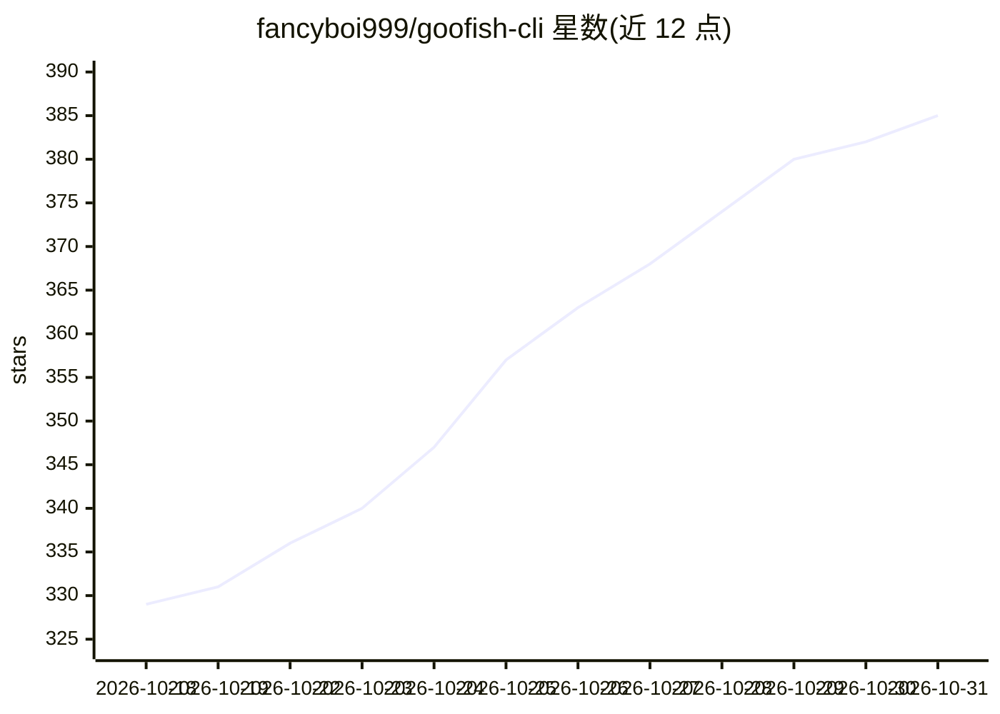

# fancyboi999/goofish-cli

⭐ 385 · Python · Apache-2.0 · 推送 2026-10-26 · [GitHub](https://github.com/fancyboi999/goofish-cli) · 个人维护 · 中文 README

**面向 AI Agent 的闲鱼运营 CLI，含 MCP server 与 Skills**

把闲鱼核心运营能力封装成结构化命令的 Python CLI，同一注册表输出给人类、MCP 客户端（Claude Code/Cursor/Codex）、Claude Skills 与 OpenClaw 四种消费者。覆盖 17 个命令：商品发布/下架/查询、图片上传、AI 类目识别、默认地址、IM 收发与会话列表，WebSocket 长连输出三类事件 JSONL。内置账号与业务桶限流（1 次/分钟、9 次/分钟）及 RGV587 自动熔断。附带 Docker 沙箱模式与 5 个内置 Claude Skill。限自有账号使用，不提供绕过风控能力。

## 筛选速览

| 维度 | 判定 | 备注 |
|---|---|---|
| AI 角色 | `ai-ecosystem` | LLM/agent 周边工具 |
| 许可风险 | `permissive` | Apache-2.0 |
| 部署形态 | `library` | 以包/库形式分发 |
| 模型依赖 | — | README 未给出锁定关系 |
| 硬件要求 | — | 无带数字的原话,不猜 |
| 安装摩擦 | `low` | 无编译、无系统依赖或容器化 |
| 成熟度 | — | 结构信号不足 |

## 能力要点

- 17 个命令：发布/下架/查询/图片上传/AI 类目识别/IM 收发
- CLI / MCP / Skill 三种入口共享同一 registry
- WebSocket 长连自动重连，输出 message/read/new_msg 三类事件 JSONL
- 账号业务桶限流 + RGV587 自动熔断；Docker 沙箱模式

## 适用场景

- 通过对话让 Claude 等 Agent 代为管理闲鱼商品与消息
- 闲鱼卖家做自有账号的自动化运营
- 以 MCP tool 形式接入 Agent 工作流处理买卖沟通

## 场景标签

 · 领域:电商自动化/AI Agent 工具

## 证据(README 行号)

> L18: `goofish-cli` 把闲鱼（Xianyu/Goofish）的核心运营能力抽成一套结构化命令，
> L22: - 🤖 **AI Agent（Claude Code / Cursor / Codex）**：`uvx goofish-cli` → 自动注册成 MCP tool
> L47: - ⚡ **一次定义，三种入口**：CLI / MCP / Skill 共享同一 registry

## 星数曲线

2026-10-18 329 → 2026-10-31 385（+56）

---
*卡片 v1 · prompt 1.4 · 生成 2026-10-21 · 置信度 high · 依据 README sha `68ea5d51a535` · [字段定义](../../DATASET.md)*
