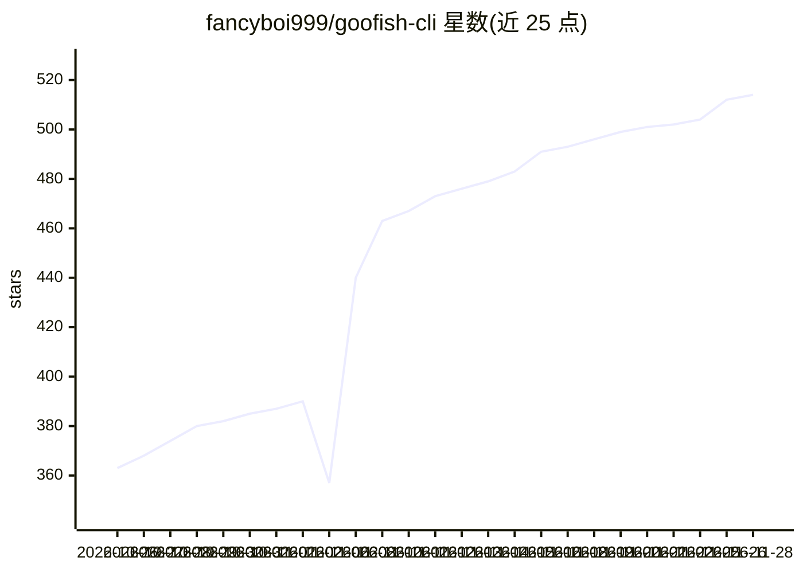

# fancyboi999/goofish-cli

⭐ 514 · Python · Apache-2.0 · 推送 2026-11-26 · [GitHub](https://github.com/fancyboi999/goofish-cli) · 个人维护 · 中文 README

**闲鱼自动化 CLI，以 MCP/skill 形式供 AI Agent 调用**

把闲鱼核心运营能力封装为 17 个结构化命令，覆盖商品发布/下架/查询、图片上传、AI 类目识别、默认地址、IM 收发与会话列表；同一命令注册表同时输出 CLI、MCP server 和 5 个 Claude Skill 三种入口。内置账号限流（经营 1 次/分钟、媒体 9 次/分钟）与 RGV587 风控熔断，支持 --format json/yaml/table/md/csv 多格式输出。提供 Docker 沙箱模式隔离桌面环境，声明仅限用户自有账号使用。

## 筛选速览

| 维度 | 判定 | 备注 |
|---|---|---|
| AI 角色 | `ai-enhanced` | 去掉 AI 部分产品仍成立 |
| 许可风险 | `permissive` | Apache-2.0 |
| 部署形态 | `library` | 以包/库形式分发 |
| 模型依赖 | — | README 未给出锁定关系 |
| 硬件要求 | — | 无带数字的原话,不猜 |
| 安装摩擦 | `low` | 无编译、无系统依赖或容器化 |
| 成熟度 | — | 结构信号不足 |

## 能力要点

- 17 个命令覆盖发布、下架、查询、图片上传、IM 收发等闲鱼核心链路
- 一次定义三种入口：CLI / MCP server / 5 个内置 Claude Skill 共享同一 registry
- WebSocket 长连实时 IM，三类事件分类 JSONL 输出并自动重连
- 账号与业务桶限流 + RGV587 自动熔断的风控护栏

## 适用场景

- 用 AI Agent 自动回复买家消息和处理议价
- 通过命令行批量发布和下架自有闲鱼商品
- 实时监控闲鱼会话消息与已读回执
- 诊断店铺曝光下滑并生成归因清单

## 场景标签

`工作流自动化` · 领域:效率与自动化

## 证据(README 行号)

> L18: `goofish-cli` 把闲鱼（Xianyu/Goofish）的核心运营能力抽成一套结构化命令，
> L22: - 🤖 **AI Agent（Claude Code / Cursor / Codex）**：`uvx goofish-cli` → 自动注册成 MCP tool
> L47: - ⚡ **一次定义，三种入口**：CLI / MCP / Skill 共享同一 registry

## 星数曲线

2026-10-26 363 → 2026-11-28 514（+151）

---
*卡片 v1 · prompt 1.4 · 生成 2026-11-27 · 置信度 high · 依据 README sha `981229b9a63c` · [字段定义](../../DATASET.md)*
