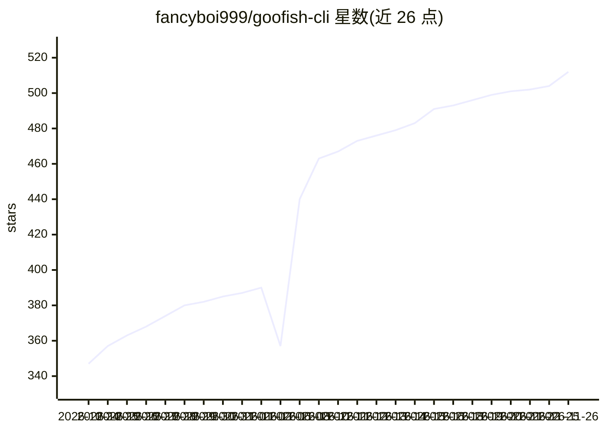

# fancyboi999/goofish-cli

⭐ 512 · Python · Apache-2.0 · 推送 2026-11-18 · [GitHub](https://github.com/fancyboi999/goofish-cli) · 个人维护 · 中文 README

**为 AI Agent 提供闲鱼运营自动化的 CLI（MCP 就绪）**

将闲鱼核心运营能力封装为 17 个结构化命令，同一 registry 输出四种入口：人类 CLI、MCP tool（接入 Claude Code/Cursor/Codex）、5 个 Claude Skills、OpenClaw ClawHub bundle。功能覆盖商品发布/下架/查询、图片上传、AI 类目识别、IM 收发与三类 WebSocket 事件输出。内置账号限流（发布 1 次/分钟、媒体 9 次/分钟）与 RGV587 自动熔断等风控护栏；搜索/浏览走 Playwright + 系统 Chrome。仅限用户自有账号使用，声明不提供绕过验证等功能。

## 筛选速览

| 维度 | 判定 | 备注 |
|---|---|---|
| AI 角色 | `ai-enhanced` | 去掉 AI 部分产品仍成立 |
| 许可风险 | `permissive` | Apache-2.0 |
| 部署形态 | `library` | 以包/库形式分发 |
| 模型依赖 | — | README 未给出锁定关系 |
| 硬件要求 | — | 无带数字的原话,不猜 |
| 安装摩擦 | `low` | 无编译、无系统依赖或容器化 |
| 成熟度 | — | 结构信号不足 |

## 能力要点

- 17 个命令覆盖发布、查询、图片上传、IM 收发等闲鱼链路
- CLI/MCP/Skill 共享同一 registry，uvx 一行接入 Claude Code
- 5 个内置 Claude Skills（发布、回复议价、风控、店铺诊断等）
- WebSocket 长连实时 IM，输出 message/read/new_msg 三类 JSONL 事件

## 适用场景

- 用 AI Agent 自动发布和管理闲鱼商品
- 让 Claude 监控并自动回复买家消息、进行议价
- 店铺流量下滑时做归因诊断
- 通过自然语言查询商品详情和会话历史

## 场景标签

`浏览器自动化` · 领域:效率与自动化

## 证据(README 行号)

> L18: `goofish-cli` 把闲鱼（Xianyu/Goofish）的核心运营能力抽成一套结构化命令，
> L22: - 🤖 **AI Agent（Claude Code / Cursor / Codex）**：`uvx goofish-cli` → 自动注册成 MCP tool
> L47: - ⚡ **一次定义，三种入口**：CLI / MCP / Skill 共享同一 registry

## 星数曲线

2026-10-24 347 → 2026-11-26 512（+165）

---
*卡片 v1 · prompt 1.4 · 生成 2026-11-25 · 置信度 high · 依据 README sha `8000cc0462ac` · [字段定义](../../DATASET.md)*
