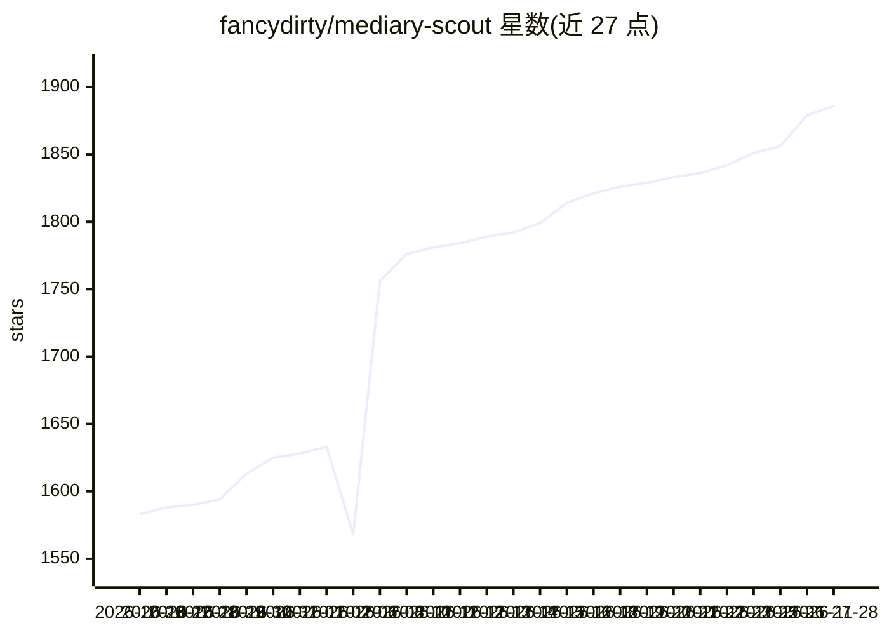

# fancydirty/mediary-scout

⭐ 1,886 · TypeScript · 0BSD · 推送 2026-11-23 · [GitHub](https://github.com/fancydirty/mediary-scout) · [官网](https://mediaryscout.app) · 个人维护 · 中文 README

**网盘用户的 AI 追更与媒体库整理工具**

自部署的开源媒体库工具：用户指定片名后，agent 自动搜索资源、转存到自己连接的网盘（夸克/UC/115/123/光鸭/天翼）、读回验证，并定时巡检补齐缺失剧集。提供 macOS/Windows 桌面版与 Docker 版两种形态，Docker 版支持多用户与 24 小时定时巡检。AI 模型接口为可选配置，未配置时默认使用 Kilo Code 公共免费模型池；资源搜索依赖 PanSou，可选接入 Prowlarr。

## 筛选速览

| 维度 | 判定 | 备注 |
|---|---|---|
| AI 角色 | `ai-enhanced` | 去掉 AI 部分产品仍成立 |
| 许可风险 | `permissive` | 0BSD |
| 部署形态 | `desktop` | 安装包/桌面程序 |
| 模型依赖 | — | README 未给出锁定关系 |
| 硬件要求 | — | 无带数字的原话,不猜 |
| 安装摩擦 | `low` | 无编译、无系统依赖或容器化 |
| 成熟度 | — | 结构信号不足 |

## 能力要点

- agent 自动完成搜资源→转存→读回验证的流程
- 支持六家网盘的分享链转存与扫码登录，多盘联合按容量与画质分配
- 桌面版与 Docker 版两种部署形态，Docker 版 24 小时定时巡检
- 提供 Agent API 供 Claude Code、Codex、OpenClaw 等 agent 操作

## 适用场景

- 自动追更剧集并补齐缺失集数
- 把资源转存到自己的多个网盘组成联合媒体库
- 在 NAS 上以 Docker 常驻部署供家庭多用户使用

## 场景标签

`工作流自动化` · 领域:效率与自动化

## 证据(README 行号)

> L4:  给你自己网盘用的 agent 驱动媒体库。
> L52: 两种形态下，自带 OpenAI 兼容的 AI 模型接口都是可选升级（key 只存在你自己的实例里）。未配置 AI 模型时，默认使用 Kilo Code 的公共免费模型池（无需注册；获取任务的对话上下文——搜索查询、任务与留言内容、

## 星数曲线

2026-10-26 1,583 → 2026-11-28 1,886（+303）

---
*卡片 v1 · prompt 1.4 · 生成 2026-11-23 · 置信度 high · 依据 README sha `b5d6ce1232ef` · [字段定义](../../DATASET.md)*
