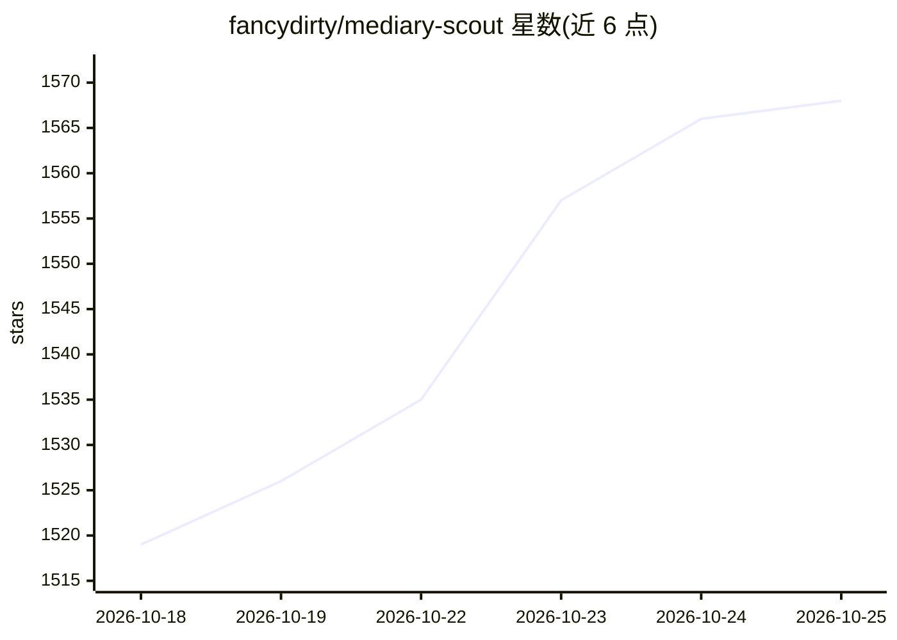

# fancydirty/mediary-scout

⭐ 1,583 · TypeScript · 0BSD · 推送 2026-10-23 · [GitHub](https://github.com/fancydirty/mediary-scout) · [官网](https://mediaryscout.app) · 个人维护 · 中文 README

**给自部署用户的 agent 驱动网盘媒体库，自动搜片转存补缺**

面向拥有夸克 / 115 / 123 / 光鸭 / 天翼网盘的自部署用户：说出想要的影视内容，agent 自动经 PanSou（可选 Prowlarr 磁力）搜索资源、选择并转存到用户自己的网盘，读回验证，缺集定时巡检补齐。AI 模型为可选配置：未配置时使用 Kilo Code 公共免费模型池（任务上下文会外发）；不配 AI 仍可完成基础操作。提供 macOS/Windows 桌面安装包与 Docker 两种形态，Docker 版支持多用户与 24 小时巡检，另有供编程 agent 调用的 Agent API。不提供托管服务。

## 筛选速览

| 维度 | 判定 | 备注 |
|---|---|---|
| AI 角色 | `ai-enhanced` | 去掉 AI 部分产品仍成立 |
| 许可风险 | `permissive` | 0BSD |
| 部署形态 | `desktop` | 安装包/桌面程序 |
| 模型依赖 | — | README 未给出锁定关系 |
| 硬件要求 | — | 无带数字的原话,不猜 |
| 安装摩擦 | `low` | 无编译、无系统依赖或容器化 |
| 成熟度 | — | 结构信号不足 |

## 能力要点

- 支持夸克 / 115 / 123 / 光鸭 / 天翼五种网盘的分享链与磁力转存
- agent 自动搜索、转存、验证、缺集补齐
- 桌面版（macOS/Windows 安装包）与 Docker 版（多用户、24 小时巡检）两种形态
- OpenAI 兼容 AI 接口可选，未配置时用 Kilo Code 免费模型池
- Agent API 供 Claude Code、Codex 等编程 agent 直接操作

## 适用场景

- 把想看的影视资源自动转存进自己的网盘并补齐缺集
- 在 NAS / 服务器上 7×24 定时巡检维护媒体库
- 通过编程 agent 或对话接口管理网盘媒体资源

## 场景标签

 · 领域:媒体库/网盘自动化

## 证据(README 行号)

> L15: 你说要哪部电影、剧或番，agent 自己去搜资源，挑最合适的转存进你自己的网盘（夸克 / 115 / 光鸭 / 123 / 天翼），转完读回来确认真的到了，之后缺哪集还会接着补。
> L52: 两种形态下，自带 OpenAI 兼容的 AI 模型接口都是可选升级（key 只存在你自己的实例里）。未配置 AI 模型时，默认使用 Kilo Code 的公共免费模型池（无需注册；获取任务的对话上下文——搜索查询、任务与留言内容、

## 星数曲线

2026-10-18 1,519 → 2026-10-25 1,568（+49）

---
*卡片 v1 · prompt 1.4 · 生成 2026-10-21 · 置信度 high · 依据 README sha `3d9a366d4bb7` · [字段定义](../../DATASET.md)*
