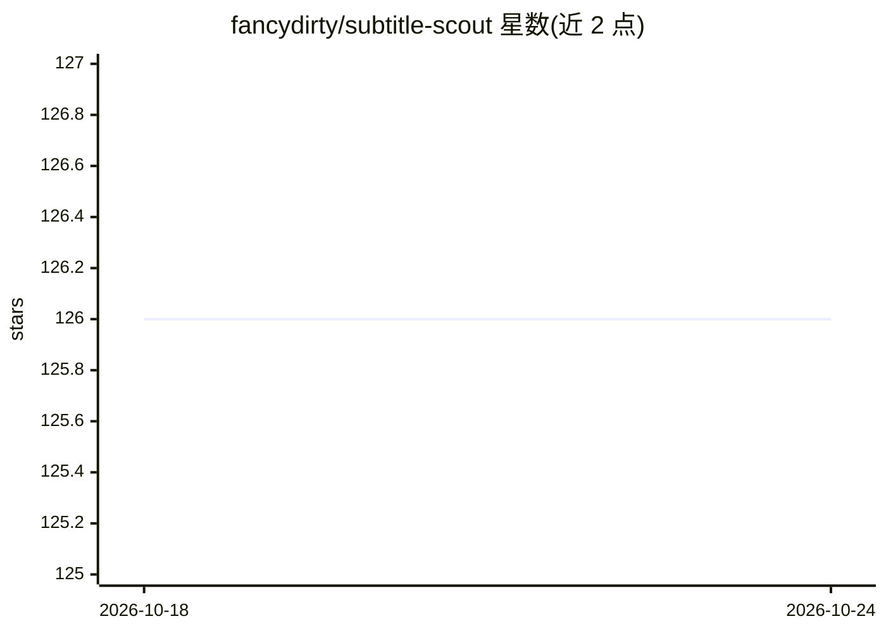

# fancydirty/subtitle-scout

⭐ 131 · TypeScript · AGPL-3.0 · 推送 2026-09-04 · [GitHub](https://github.com/fancydirty/subtitle-scout) · [官网](https://subtitlescout.com) · 个人维护 · 中文 README

**自托管字幕自动化系统：LLM agent 为媒体库匹配并安装字幕**

面向自托管用户（NAS/本地媒体库）的字幕自动化应用：以 LLM agent 为核心，对每个缺字幕的剧集/电影循环执行多源搜索（OpenSubtitles、SubDL、ASSRT 等 7 个源）、下载候选到沙箱做结构校验（cue 数、时间线与时长匹配、编码）并由模型判定归属，装上最适配的一条；无可用源时由第二个 agent 先过术语表再逐句翻译。直接扫描文件夹，不依赖 Plex/Jellyfin/Sonarr 等。凭据保存在本地 SQLite。需 TMDB API key 与 OpenAI 兼容的 LLM key，通过 Docker Compose 部署，网页向导完成配置。

## 筛选速览

| 维度 | 判定 | 备注 |
|---|---|---|
| AI 角色 | `ai-native` | 本体是模型或模型工具 |
| 许可风险 | `viral` | AGPL-3.0 |
| 部署形态 | `self-host` | docker 或自建部署 |
| 模型依赖 | — | README 未给出锁定关系 |
| 硬件要求 | — | 无带数字的原话,不猜 |
| 安装摩擦 | `low` | 无编译、无系统依赖或容器化 |
| 成熟度 | — | 结构信号不足 |

## 能力要点

- LLM agent 循环式多源搜索与逐条候选归属判定（7 个字幕源）
- 候选字幕沙箱下载后做结构校验（cue 数、时间线、编码）
- 无源时经术语表预处理的第二 agent 逐句翻译
- 直接扫描媒体目录，无需 Plex/Jellyfin/Sonarr/Radarr

## 适用场景

- 给 NAS 或本地媒体库自动补齐缺失的中文字幕
- 判定候选字幕是否属于正确剧集与版本，避免装错
- 仅有日文源字幕时自动翻译成中文

## 场景标签

`工作流自动化` · 领域:效率与自动化

## 证据(README 行号)

> L22: For every episode or movie missing a subtitle in your target language, an agent runs a loop instead of a fixed pipe
> L28: - **Translates when there is no source.** Want Chinese and only a Japanese sub exists? A second agent translates se

## 星数曲线

2026-10-18 126 → 2026-10-24 126（+0）

---
*卡片 v1 · prompt 1.4 · 生成 2026-10-23 · 置信度 mid · 依据 README sha `eb8ec33d2abe` · [字段定义](../../DATASET.md)*
