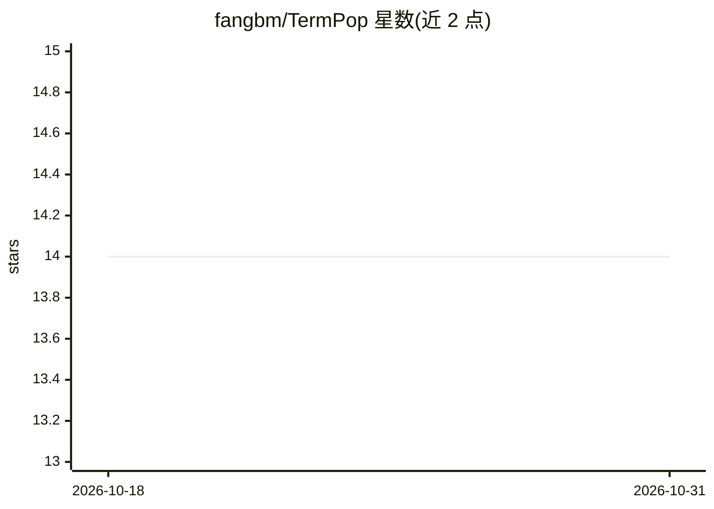

# fangbm/TermPop

⭐ 14 · TypeScript · MIT · 推送 2026-09-16 · [GitHub](https://github.com/fangbm/TermPop) · [官网](https://termpop.com) · 个人维护 · 中文 README

**浏览器扩展：阅读时即点即释技术术语，BYOK 可接 LLM**

Chrome/Edge 的 Manifest V3 浏览器扩展，用于阅读时理解技术术语：悬停扫描页面并高亮术语、划词通过右键菜单解释、截图识别非 DOM 文本（可选本地 Tesseract OCR 或多模态 LLM），并自带 PDF 查看器。术语匹配核心为 Rust 编译的 WebAssembly，在本地浏览器内运行；LLM 增强（领域术语补充与解释生成）由用户自行配置 provider 与 API key（OpenAI/Kimi/OpenAI 兼容/Anthropic 风格），本地优先、无托管后端。公开版不提供账户、计费或团队功能，扩展存储非加固密钥存储。

## 筛选速览

| 维度 | 判定 | 备注 |
|---|---|---|
| AI 角色 | `ai-native` | 本体是模型或模型工具 |
| 许可风险 | `permissive` | MIT |
| 部署形态 | `library` | 以包/库形式分发 |
| 模型依赖 | — | README 未给出锁定关系 |
| 硬件要求 | — | 无带数字的原话,不猜 |
| 安装摩擦 | `low` | 无编译、无系统依赖或容器化 |
| 成熟度 | — | 结构信号不足 |

## 能力要点

- Rust + WASM 本地术语匹配，本地优先且无遥测与自有后端
- BYOK 接入 OpenAI、Kimi、OpenAI 兼容与 Anthropic 风格 provider
- 三种截图识别模式：自动/多模态 LLM/本地 Tesseract OCR
- 术语与解释双缓存，按域名/页面/全局复用并可忽略术语

## 适用场景

- 阅读技术文档时不用离开页面就能查术语含义
- 对图片或 PDF 里的词汇截图并获取解释
- 用自己的 LLM API key 获得更丰富的术语检测与解释

## 场景标签

 · 领域:浏览器工具/阅读辅助

## 证据(README 行号)

> L7: TermPop is an open-source browser extension for Chrome and Microsoft Edge. It highlights technical vocabulary while 
> L32: - **LLM enrichment** can add domain-specific terms and generate explanations through a provider you configure.

## 星数曲线

2026-10-18 14 → 2026-10-31 14（+0）

---
*卡片 v1 · prompt 1.4 · 生成 2026-10-31 · 置信度 high · 依据 README sha `1ad3c97fa671` · [字段定义](../../DATASET.md)*
